<picture>
  <source media="(prefers-color-scheme: dark)" srcset=".github/assets/hero-banner-dark.svg">
  <source media="(prefers-color-scheme: light)" srcset=".github/assets/hero-banner-light.svg">
  
</picture>

<p align="center">
  <a href="LICENSE"></a>
  <a href="https://github.com/Aboudjem/10x/actions/workflows/validate.yml"></a>
</p>

<p align="center">
  <b>English</b> ·
  <a href="READMEs/zh-CN.md">简体中文</a> ·
  <a href="READMEs/ja.md">日本語</a> ·
  <a href="READMEs/es.md">Español</a> ·
  <a href="READMEs/fr.md">Français</a>
</p>

<p align="center"><b>Nine agent tools, each with proof, from one list.</b></p>

<p align="center">
  <a href="#the-plugins">The plugins</a> ·
  <a href="#install">Install</a> ·
  <a href="#how-it-works">How it works</a> ·
  <a href="#proof">Proof</a> ·
  <a href="#faq">FAQ</a> ·
  <a href="#limits">Limits</a>
</p>

Add the list once, then install any tool by its name.

| Install by name | Proof for each tool | Clear limits |
|:--|:--|:--|
| `npm run validate` prints `Marketplace has 9 valid plugin(s)`. | Each plugin README has a Proof section with commands you can re-run. | Each plugin README has a Limits section that says what it cannot do. |

**Works with:** Claude Code, and more than 70 other agents through `npx skills`.
Three tools also run as MCP servers. MCP is the standard way an agent calls a tool.
No tool is tied to one model: skills are plain Markdown files.

```bash
# Any agent: install one tool for all your projects
npx skills add Aboudjem/humanizer-skill -g
# Claude Code: add the list once, then install by name
claude plugin marketplace add Aboudjem/10x
claude plugin install humanizer@10x
```

What the two Claude Code commands print (real run, 2026-11-17):

```text
✔ Successfully added marketplace: 10x (declared in user settings)
✔ Successfully installed plugin: humanizer@10x (scope: user)
```

- **What it is:** a list of nine tools for coding agents.
- **When to use it:** you have one job, such as finding bugs or cutting AWS costs.
- **What you get:** one install command per tool, and a README with its proof and limits.

10x only lists plugins. Each one runs with your permissions, so read its repo first.

## The plugins

| | Plugin | One line | Chips |
|:-:|:--|:--|:--|
|  | [**sniff**](https://github.com/Aboudjem/sniff) | Catch broken pages in your web app before users do. | Bugs caught before users · Steps to repeat it · Broken merges blocked |
|  | [**ui-ux-suite**](https://github.com/Aboudjem/ui-ux-suite) | Design bugs by line number, each with the exact fix. | Exact line to fix · WCAG rule cited · Fix value given |
|  | [**recap-studio**](https://github.com/Aboudjem/recap-studio) | Understand what changed, in one page you can send. | Understand what was done · One page to send · Checked before you send |
|  | [**aws-cost-audit**](https://github.com/Aboudjem/aws-cost-audit-skill) | Find what to stop paying for on your AWS bill. | Lower AWS bill · Prices checked against AWS · Rollback before any change |
|  | [**goalify**](https://github.com/Aboudjem/goalify) | Give your agent a big job and get proof back. | Questions asked once · Plan saved to file · Proof it is done |
|  | [**humanizer**](https://github.com/Aboudjem/humanizer-skill) | See why your draft sounds like AI, then fix it. | Know which words · Reads more human · Facts kept |
|  | [**loopify**](https://github.com/Aboudjem/loopify) | Check a repeating agent job in one line. | No babysitting · Fewer stuck ticks · Stops by itself |
|  | [**secure-my-app**](https://github.com/Aboudjem/secure-my-app) | Find what a stranger can take from your app. | Fixes proven closed · Proof for each hole · No surprise changes |
|  | [**contextify**](https://github.com/Aboudjem/contextify) | One AGENTS.md for your agents, checked with zero tokens. | Time saved · Context kept · Tokens saved |

Each line and each chip comes from the tool's own README. [What each one does](#what-each-one-does) gives the proof.

## Install

**Recommended: the Vercel skills CLI.** `npx skills` is Vercel's open installer for agent skills.
One command installs one tool for all your projects:

```bash
npx skills add Aboudjem/sniff -g
```

Works in more than 70 agents: pick yours in the menu ([supported agents](https://github.com/vercel-labs/skills#supported-agents)).
In a terminal it shows the agent menu. In a script it installs into every agent folder, so add `-a <agent>` there.
Only this project: drop `-g`.

Use the tool's repo name, not `Aboudjem/10x`. This repo is the list and holds no skills of its own.

| Tool | Command | Page |
|:--|:--|:--|
| sniff | `npx skills add Aboudjem/sniff -g` | [skills.sh](https://skills.sh/aboudjem/sniff) |
| ui-ux-suite | `npx skills add Aboudjem/ui-ux-suite -g` | [skills.sh](https://skills.sh/aboudjem/ui-ux-suite) |
| recap-studio | `npx skills add Aboudjem/recap-studio -g` | [skills.sh](https://skills.sh/aboudjem/recap-studio) |
| aws-cost-audit | `npx skills add Aboudjem/aws-cost-audit-skill -g` | [skills.sh](https://skills.sh/aboudjem/aws-cost-audit-skill) |
| goalify | `npx skills add Aboudjem/goalify -g` | [skills.sh](https://skills.sh/aboudjem/goalify) |
| humanizer | `npx skills add Aboudjem/humanizer-skill -g` | [skills.sh](https://skills.sh/aboudjem/humanizer-skill) |
| loopify | `npx skills add Aboudjem/loopify -g` | [skills.sh](https://skills.sh/aboudjem/loopify) |
| secure-my-app | `npx skills add Aboudjem/secure-my-app -g` | [skills.sh](https://skills.sh/aboudjem/secure-my-app) |
| contextify | `npx skills add Aboudjem/contextify -g` | [skills.sh](https://skills.sh/aboudjem/contextify) |

It installs the skills only. The three MCP servers are a separate one-line step: see [MCP servers](#mcp-servers).

**Or install straight into one agent.** Each command installs for all your projects.

<a href="#claude-code"></a> <a href="#codex"></a> <a href="#cursor"></a> <a href="#gemini-cli"></a> <a href="#github-copilot"></a> <a href="#opencode"></a> <a href="https://skills.sh/aboudjem"></a>

Swap `<repo>` for a repo name from the table above.
Install tested for all nine tools on 2026-11-17, into an empty home folder.

#### Claude Code

```bash
npx skills add Aboudjem/<repo> -g -a claude-code
```

#### Codex

```bash
npx skills add Aboudjem/<repo> -g -a codex
```

#### Cursor

```bash
npx skills add Aboudjem/<repo> -g -a cursor
```

#### Gemini CLI

```bash
npx skills add Aboudjem/<repo> -g -a gemini-cli
```

#### GitHub Copilot

```bash
npx skills add Aboudjem/<repo> -g -a github-copilot
```

#### OpenCode

```bash
npx skills add Aboudjem/<repo> -g -a opencode
```

**Claude Code plugin.** Add the list once, then install by name.
For three tools, the plugin adds more than the skills:

- sniff: the MCP server.
- ui-ux-suite: 5 slash commands, 12 agents and the MCP server.
- recap-studio: 13 agents, safety hooks and the MCP server.

```bash
claude plugin marketplace add Aboudjem/10x
claude plugin install sniff@10x
```

Swap `sniff` for any name in [the plugins](#the-plugins) table.
Claude Code plugins install per user, so they work in all your projects.

### MCP servers

MCP is the standard way an agent calls a tool. Three tools ship an MCP server:

```bash
npx sniff-qa --mcp
npx ui-ux-suite --mcp
npx -y github:Aboudjem/recap-studio mcp
```

Each repo's `docs/editors.md` shows how to add the server to your editor. The other six ship no MCP server.

## What each one does

#### sniff

**Catch broken pages in your web app before users do.**

- **Bugs caught before users.** Found 21 of 21 planted bugs, 0 false findings: `npm run build && npm run proof`.
- **Steps to repeat it.** Each page bug comes with its route, the steps to repeat it, and a fix.
- **Broken merges blocked.** `--fail-on` exits 1 on critical or high bugs, so CI stops the merge.

Limit: use a dev or staging app. A walk clicks buttons and submits real forms.

```bash
npx sniff-qa --url http://localhost:3000
npx skills add Aboudjem/sniff -g
claude plugin install sniff@10x
```

[GitHub](https://github.com/Aboudjem/sniff) · [npm](https://www.npmjs.com/package/sniff-qa)

#### ui-ux-suite

**Design bugs by line number, each with the exact fix.**

- **Exact line to fix.** 46 located findings on the test app, each with a file and a line.
- **WCAG rule cited.** Contrast is measured against WCAG 2.2. Each finding cites a WCAG rule or UX law.
- **Fix value given.** Each one shows the measured value and the change, such as `#fbfbfb` to `#767676`.

Limit: it reads source, not pixels, and it never edits your code.

```bash
npx ui-ux-suite .
npx skills add Aboudjem/ui-ux-suite -g
claude plugin install ui-ux-suite@10x
```

[GitHub](https://github.com/Aboudjem/ui-ux-suite) · [npm](https://www.npmjs.com/package/ui-ux-suite)

#### recap-studio

**Understand what changed, in one page you can send.**

- **Understand what was done.** `/recap session` reads your git diff and commits, then writes one page.
- **One page to send.** One HTML file, 0 script tags, all CSS inside. The demo prints both.
- **Checked before you send.** Seven checks score the page with no model. `--fail-under 8` refuses a weak page.

Limit: the score checks shape, not truth, so read the sources before you share.

```bash
npx -y github:Aboudjem/recap-studio demo
npx skills add Aboudjem/recap-studio -g
claude plugin install recap-studio@10x
```

[GitHub](https://github.com/Aboudjem/recap-studio) · [Architecture](https://github.com/Aboudjem/recap-studio/blob/main/docs/architecture.md)

#### aws-cost-audit

**Find what to stop paying for on your AWS bill.**

- **Lower AWS bill.** Each report opens with a dollar verdict and the three cuts to make first.
- **Prices checked against AWS.** Each price records its AWS lookup. `make test` shows a figure without one is rejected.
- **Rollback before any change.** Scripts do a dry run by default. `--apply` saves a rollback file first, then asks, unless `--yes`.

Limit: it needs the AWS CLI v2, bash and `jq`, and Cost Explorer turned on.

```bash
npx skills add Aboudjem/aws-cost-audit-skill -g
claude plugin install aws-cost-audit@10x
```

[GitHub](https://github.com/Aboudjem/aws-cost-audit-skill)

#### goalify

**Give your agent a big job and get proof back.**

- **Questions asked once.** Every question comes first, once. The answers sit in the brief under "Decisions".
- **Plan saved to file.** The run re-reads the brief file, so it can start in a clean chat.
- **Proof it is done.** `/goalify verify` re-runs your tests: `make demo` VERIFIED, `--broken` NOT VERIFIED.

Limit: a stopped run is not always done, and it can pause on a permission prompt.

```bash
npx skills add Aboudjem/goalify -g
claude plugin install goalify@10x
```

[GitHub](https://github.com/Aboudjem/goalify)

#### humanizer

**See why your draft sounds like AI, then fix it.**

- **Know which words.** It quotes each word that sounds like AI. The CLI ranks them in a "Fix first" list.
- **Reads more human.** The bundled example drops from 57 to 6 out of 100. Lower is more human.
- **Facts kept.** The CLI's `compare --check-facts` fails a rewrite that lost a number, date, version or URL.

Limit: it is not an AI detector, and it does not promise to pass one.

```bash
npx skills add Aboudjem/humanizer-skill -g
claude plugin install humanizer@10x
```

[GitHub](https://github.com/Aboudjem/humanizer-skill)

#### loopify

**Check a repeating agent job in one line.**

- **No babysitting.** `loop_status.py` prints one of six verdicts, then up to three things to do.
- **Fewer stuck ticks.** loopify prints the commands to allow first, such as `gh pr view`. A tick is one run of the job.
- **Stops by itself.** The line carries a stop rule. Every `/loop` ends after 7 days.

Limit: the loop lives in your open session. Close the terminal and it stops.

```bash
npx skills add Aboudjem/loopify -g
claude plugin install loopify@10x
```

[GitHub](https://github.com/Aboudjem/loopify)

#### secure-my-app

**Find what a stranger can take from your app.**

- **Fixes proven closed.** A fix counts only when its VERIFY output changes. All 11 sample findings have one.
- **Proof for each hole.** Each finding shows its proof. `make test` replays the proof behind all 11 sample findings.
- **No surprise changes.** It writes a report and stops. Each fix waits for your yes.

Limit: it is not a penetration test (a paid attack by an expert).

```bash
npx skills add Aboudjem/secure-my-app -g
claude plugin install secure-my-app@10x
```

[GitHub](https://github.com/Aboudjem/secure-my-app)

#### contextify

**One AGENTS.md for your agents, checked with zero tokens.**

- **Time saved.** The warning names the file, the line and the missing command.
- **Context kept.** One file of 20, 40 or 60 lines, by repo size. The `CLAUDE.md` pointer is 4 lines.
- **Tokens saved.** The check for stale lines is a local script. It calls no model, so it costs zero tokens.

Limit: it checks that a command exists. It does not run the command.

```bash
npx skills add Aboudjem/contextify -g
claude plugin install contextify@10x
```

[GitHub](https://github.com/Aboudjem/contextify)

## How it works

10x is one file: [`.claude-plugin/marketplace.json`](.claude-plugin/marketplace.json). It holds no plugin code.

1. Each entry names a plugin, its GitHub repo, and the version listed here.
2. `claude plugin marketplace add Aboudjem/10x` clones this repo and reads that file.
3. `claude plugin install <name>@10x` fetches the plugin from its own repo.
4. A scheduled job re-reads every plugin repo and updates the version numbers. [docs/SYNC.md](docs/SYNC.md) explains the chain.

The `npx skills` route skips this file. It copies the skills from the tool's own repo into your agent's folder.

### Other agents

<p align="center">
  
</p>

Every plugin here ships as skills, which are Markdown files your agent reads.
That is why all nine install outside Claude Code through `npx skills add`.

| Agent | One-line install |
|:--|:--|
| Claude Code | `claude plugin install <name>@10x` |
| Cursor, Codex, Copilot, Gemini CLI, and [the rest of the list](https://github.com/vercel-labs/skills#supported-agents) | `npx skills add Aboudjem/<repo> -g` |
| Any MCP client | `npx sniff-qa --mcp`, `npx ui-ux-suite --mcp`, `npx -y github:Aboudjem/recap-studio mcp` |
| Everything else | see `docs/editors.md` in the plugin's own repo |

## Proof

Each claim below comes with the command that prints it. Run them from a clone of this repo.

| Claim | Command | Line to look for in its output |
|:--|:--|:--|
| The list holds nine valid plugins | `npm run validate` | `All checks passed. Marketplace has 9 valid plugin(s).` |
| Every listed version matches the plugin's own repo | `npm run sync:check` | `drift: none` (if a repo cannot be read, it prints `unverified: <n> of 9 ...` and exits 1) |
| The manifest loads in Claude Code | `claude plugin validate . --strict` | `✔ Validation passed` |
| The repo's own tests pass | `npm test` | `# fail 0` |

CI (the automatic checks on GitHub) runs all four on every push and pull request. It also checks every link and scans for secrets.

### The 10x bar

| | |
|---|---|
| **Lean by default** | No dependency a plugin does not need. ui-ux-suite and the six skills ship none. recap-studio's packages pull zod, its web app Next and React. sniff depends on `zod` only and downloads its browser engine and Chromium on first use (about 440 MB). |
| **One-command install** | No config file and no signup. aws-cost-audit is the one that needs access you may not have: an AWS CLI configured to read the account. |
| **Real tests** | CI that checks behaviour, not only that a file exists. |
| **Runs outside Claude Code** | Installs into other agents through `npx skills add`. |
| **Actively maintained** | A release this quarter, not an archive from last year. |
| **No telemetry** | No analytics and no phoning home. Network calls serve the job, for example sniff's browser download and its check of your pages' external links. |

Every plugin listed here is held to this bar. If one stops passing, it gets removed.
The full checklist, the roster and the last verification date are in [QUALITY-BAR.md](QUALITY-BAR.md).

## FAQ

### What is a plugin marketplace?

A plugin marketplace is a list your editor can install from. You add the list once, then install any plugin on it by name.

### Do I have to install all nine?

No. Adding the marketplace installs nothing. Each `claude plugin install <name>@10x` or `npx skills add` installs one tool.

### Does it work without Claude Code?

Yes, one tool at a time. Run `npx skills add Aboudjem/<repo> -g` with the repo name from the table.

### Why does `npx skills add Aboudjem/10x` find no skills?

This repo is only the list. The skills live in each plugin's own repo, so point the command at that repo.

### How do I update or remove a plugin?

Run `claude plugin update <name>@10x` to update. Run `claude plugin uninstall <name>@10x` to remove it.
With the skills CLI, run `npx skills update` or `npx skills remove <skill>`.

### Does 10x collect any data?

No. 10x has no analytics. Adding the list clones this repo and runs nothing. Its scripts and tests run only when you run them in a clone.

## Limits

- 10x lists plugins. It does not sandbox them. A plugin runs with your permissions.
- The Claude Code commands need the `claude` CLI. Other agents use `npx skills add`, one plugin repo at a time.
- `npx skills` installs the skills only. Only three plugins ship an MCP server: sniff, ui-ux-suite and recap-studio.
- aws-cost-audit needs an AWS CLI that can read your account, and `jq`.
- sniff's first walk downloads a browser engine and Chromium once: about 440 MB, then about 730 MB on disk on a Mac. `npx sniff-qa install` does it ahead of time, and the MCP tool `sniff_install` reports progress.
- Until that download is complete, even after one cut midway, sniff returns setup steps: an install hint in the CLI, `needsSetup` in MCP.
- sniff's MCP server answers before that download. Its README measured 3.1 to 4.9 s on an empty npm cache, under Claude Code's 30 s connect limit.
- `claude plugin list` can show recap-studio's note "The packages it lists were not installed". It is harmless: the plugin runs from one bundled file.
- The version listed here can trail a new plugin release by up to six hours, until the sync job runs.
- Each plugin keeps its own license. sniff is Apache-2.0, the other eight are MIT.

## Contributing

Have a plugin that belongs here? [CONTRIBUTING.md](CONTRIBUTING.md) has the proposal steps.
A workflow syncs every listed version from the plugin's own repo. [docs/SYNC.md](docs/SYNC.md) explains the chain.

<p align="center">
  <sub>Built by <a href="https://github.com/Aboudjem">Adam Boudjemaa</a> · MIT License · No telemetry, no data collection</sub>
</p>
