<picture>
  <source media="(prefers-color-scheme: dark)" srcset="../.github/assets/hero-banner-dark.svg">
  <source media="(prefers-color-scheme: light)" srcset="../.github/assets/hero-banner-light.svg">
  
</picture>

<p align="center">
  <a href="../LICENSE"></a>
  <a href="https://github.com/Aboudjem/10x/actions/workflows/validate.yml"></a>
</p>

<p align="center">
  <a href="../README.md">English</a> ·
  <a href="zh-CN.md">简体中文</a> ·
  <a href="ja.md">日本語</a> ·
  <b>Español</b> ·
  <a href="fr.md">Français</a>
</p>

<p align="center"><b>Nueve herramientas para Claude Code. Una lista. Una prueba para cada una.</b></p>

<p align="center">
  <a href="#install">Instalación</a> ·
  <a href="#the-plugins">Los plugins</a> ·
  <a href="#how-it-works">Cómo funciona</a> ·
  <a href="#proof">Pruebas</a> ·
  <a href="#faq">FAQ</a> ·
  <a href="#limits">Límites</a>
</p>

Agrega esta lista una vez y luego instala cualquiera de las nueve herramientas por su nombre.

```bash
claude plugin marketplace add Aboudjem/10x
claude plugin install humanizer@10x
```

Lo que ves después de esos dos comandos (ejecución real, 2026-11-17):

```text
✔ Successfully added marketplace: 10x (declared in user settings)
✔ Successfully installed plugin: humanizer@10x (scope: user)
```

Encuentra lo que falla en tu app, lo que un extraño puede llevarse y lo que desperdicia tu factura de AWS.
Haz que un borrador de IA se lea como escrito por una persona, y delega trabajos largos con un recibo.
Cada plugin lista los comandos que prueban lo que dice.

10x lista plugins, no los aísla: cada uno se ejecuta con tus permisos.

<a id="why-use-it"></a>

## Por qué usarlo

- **Un alta, nueve herramientas.** Agregar la lista no instala nada. `claude plugin install <name>@10x` instala una herramienta.
  Prueba: `npm run validate` imprime `Marketplace has 9 valid plugin(s)`.
- **Revisado en cada push.** La CI ejecuta `npm run validate`, `npm run sync:check`, `claude plugin validate . --strict` y `npm test`.
  Prueba: el [workflow validate](../.github/workflows/validate.yml) y la tabla de [Pruebas](#proof) más abajo.
- **Límites a la vista.** El README de cada plugin tiene una sección Proof y una sección Limits que dice lo que no puede hacer.
  Prueba: abre cualquier enlace de repo en [Los plugins](#the-plugins) y lee sus `## Proof` y `## Limits`.

<a id="install"></a>

## Instalación

Agrega el marketplace una sola vez. Claude Code puede entonces instalar cualquiera de los nueve por su nombre.

```bash
claude plugin marketplace add Aboudjem/10x
claude plugin install sniff@10x
```

Cambia `sniff` por cualquier nombre de la tabla de abajo.

Un plugin puede ejecutar comandos y leer archivos con tus permisos. Lee el repo de un plugin antes de instalarlo.

¿No usas Claude Code? Instala un plugin a la vez con el [Vercel skills CLI](https://github.com/vercel-labs/skills).
Copia las skills en la carpeta que lee tu agente.

```bash
npx skills add Aboudjem/sniff
```

Usa el nombre del repo del plugin, no `Aboudjem/10x`. Este repo es una lista y no contiene skills propias.

<a id="the-plugins"></a>
## Los plugins

| | Plugin | Para qué sirve | Instalación | |
|:-:|:--|:--|:--|:--|
|  | **sniff** | Atrapa los 500, enlaces rotos y formularios rotos de tu app, con los pasos. | `claude plugin install sniff@10x` | [repo](https://github.com/Aboudjem/sniff) |
|  | **ui-ux-suite** | Arregla contraste, foco y maquetación: archivo, línea, valor medido y cambio. | `claude plugin install ui-ux-suite@10x` | [repo](https://github.com/Aboudjem/ui-ux-suite) |
|  | **recap-studio** | Explica un tema o tu sesión en una página HTML que abre sin conexión. | `claude plugin install recap-studio@10x` | [repo](https://github.com/Aboudjem/recap-studio) |
|  | **aws-cost-audit** | Recorta tu factura de AWS: una lista ordenada de recortes, cada precio comprobado en vivo. | `claude plugin install aws-cost-audit@10x` | [repo](https://github.com/Aboudjem/aws-cost-audit-skill) |
|  | **goalify** | Delega un trabajo grande y recibe un recibo: VERIFIED o NOT VERIFIED. | `claude plugin install goalify@10x` | [repo](https://github.com/Aboudjem/goalify) |
|  | **humanizer** | Mira qué hace sonar un borrador a IA y reescríbelo con la voz que elijas. | `claude plugin install humanizer@10x` | [repo](https://github.com/Aboudjem/humanizer-skill) |
|  | **loopify** | Ejecuta una tarea repetida y revísala en una línea: OK, NEEDS YOU, STALE. | `claude plugin install loopify@10x` | [repo](https://github.com/Aboudjem/loopify) |
|  | **secure-my-app** | Encuentra lo que un extraño puede llevarse de tu app, con la prueba de cada hueco. | `claude plugin install secure-my-app@10x` | [repo](https://github.com/Aboudjem/secure-my-app) |
|  | **contextify** | Un AGENTS.md para tus agentes, y una revisión sin tokens de comandos y archivos muertos. | `claude plugin install contextify@10x` | [repo](https://github.com/Aboudjem/contextify) |

<a id="what-each-one-does"></a>

### Qué hace cada uno

#### sniff

**Atrapa los 500, los enlaces rotos y los formularios rotos de tu app en marcha.**

- Cada hallazgo de página nombra la ruta, los pasos y un arreglo, casi siempre con captura.
- Encontró 21 de 21 bugs plantados, con 0 hallazgos falsos en la página limpia (`npm run build && npm run proof`).
- `--fail-on` sale con código 1 ante hallazgos críticos o altos, así que puede bloquear un merge. Sin clave de API.

Envía formularios reales, así que apúntalo a una app de desarrollo o staging.

`claude plugin install sniff@10x`

[GitHub](https://github.com/Aboudjem/sniff) · [npm](https://www.npmjs.com/package/sniff-qa)

#### ui-ux-suite

**ESLint para el diseño: la línea, el valor medido, el arreglo.**

- Cada hallazgo localizado tiene archivo, línea, valor medido y arreglo (46 en el fixture roto).
- Comprueba el contraste según WCAG 2.2, y cada hallazgo localizado cita la regla o ley de UX detrás.
- Sin dependencias en tiempo de ejecución: `npm view ui-ux-suite dependencies` no imprime nada.

Lee el código fuente, no los píxeles, y nunca edita tu código.

`claude plugin install ui-ux-suite@10x`

[GitHub](https://github.com/Aboudjem/ui-ux-suite) · [npm](https://www.npmjs.com/package/ui-ux-suite)

#### recap-studio

**Una página que puedes enviar por correo, adjuntar a un PR o leer en un avión.**

- Un solo archivo HTML, 0 etiquetas script y todo el CSS en línea. Abre sin conexión con doble clic.
- Siete comprobaciones sin conexión puntúan la página sin modelo. `--fail-under 8` rechaza una página floja.
- `/recap session` convierte tu diff de git y tus commits en una página que tu equipo puede leer.

La nota mide la forma, no la verdad, así que lee primero las fuentes.

`claude plugin install recap-studio@10x`

[GitHub](https://github.com/Aboudjem/recap-studio) · [Arquitectura](https://github.com/Aboudjem/recap-studio/blob/main/docs/architecture.md)

#### aws-cost-audit

**Recorta el desperdicio de tu factura de AWS, con precios en vivo.**

- Un veredicto en dólares y luego los tres recortes que hacer primero.
- Los precios vienen de AWS al ejecutarse. `make test` y un escaneo de CI fallan si un script contiene un precio literal.
- Simulación por defecto: un cambio necesita `--apply` y tu sí escrito.

Necesita una AWS CLI que pueda leer tu cuenta, y Cost Explorer activado.

`claude plugin install aws-cost-audit@10x`

[GitHub](https://github.com/Aboudjem/aws-cost-audit-skill)

#### goalify

**Dale a tu IA un trabajo grande. Recibe una prueba.**

- Todas las preguntas van primero, así que la ejecución no tiene nada más que preguntarte.
- La línea de `/goal` nombra el comando de test que debe pasar.
- `/goalify verify` vuelve a ejecutar tus tests y escribe un recibo que puede decir `NOT VERIFIED`.

Una ejecución que se detiene no siempre está terminada, y aún puede pausarse en una solicitud de permiso.

`claude plugin install goalify@10x`

[GitHub](https://github.com/Aboudjem/goalify)

#### humanizer

**Encuentra lo que hace sonar tu borrador a IA. Arréglalo.**

- 55 patrones numerados y una lista «Fix first» que cita las palabras que restan puntos.
- En la CLI opcional, `compare --check-facts` falla una reescritura que perdió un número, una fecha, una versión o una URL.
- `scan --fail-above 40` sale con código 1 ante un borrador con puntuación alta, así que la CI puede frenarlo.

La reescritura corre en el modelo de tu editor, con una de las cinco voces que elijas.

`claude plugin install humanizer@10x`

[GitHub](https://github.com/Aboudjem/humanizer-skill)

#### loopify

**Deja de vigilar tu bucle.**

- Una línea de estado dice `OK`, `NEEDS YOU` o `STALE`, y luego qué hacer.
- Un tick que no escribe en el registro aparece como `STALE` tras dos intervalos.
- Una regla de parada viaja en la línea, y cada bucle caduca a los 7 días.

El bucle vive en tu sesión abierta, y su registro es la única prueba de lo que hizo.

`claude plugin install loopify@10x`

[GitHub](https://github.com/Aboudjem/loopify)

#### secure-my-app

**Encuentra lo que un extraño puede llevarse de tu app. Luego ciérralo y prueba que quedó cerrado.**

- Cada hallazgo muestra su prueba: la línea de código y, con una URL en vivo, la petición y su salida real.
- Cada hallazgo tiene un comando `VERIFY` cuya salida debe cambiar para que un arreglo cuente.
- Escribe un informe y se detiene. Nada cambia en tu app hasta que apruebes un arreglo.

No es una prueba de penetración. Sin una URL en vivo, la mayoría de los controles de acceso salen `UNPROVEN`.

`claude plugin install secure-my-app@10x`

[GitHub](https://github.com/Aboudjem/secure-my-app)

#### contextify

**Entérate cuando tus instrucciones de agente apuntan a algo que ya no existe.**

- El aviso da el archivo, la línea y el comando muerto.
- Un solo `AGENTS.md` que Codex, Cursor y Copilot leen directamente, más punteros cortos para Claude Code y Gemini CLI.
- Un script local sin modelo y sin llamadas de red. Se queda callado cuando el repo está al día.

Resuelve comandos, objetivos y archivos. No ejecuta los comandos ni lee la prosa.

`claude plugin install contextify@10x`

[GitHub](https://github.com/Aboudjem/contextify)

<a id="how-it-works"></a>

## Cómo funciona

10x es un solo archivo: [`.claude-plugin/marketplace.json`](../.claude-plugin/marketplace.json). No contiene código de ningún plugin.

1. Cada entrada nombra un plugin, su repo de GitHub y la versión listada aquí.
2. `claude plugin marketplace add Aboudjem/10x` clona este repo y lee ese archivo.
3. `claude plugin install <name>@10x` descarga el plugin desde su propio repo.
4. Una tarea programada vuelve a leer cada repo de plugin y actualiza los números de versión. [docs/SYNC.md](../docs/SYNC.md) explica la cadena.

<a id="other-agents"></a>

### Otros agentes

<p align="center">
  
</p>

Cada plugin de aquí se distribuye como skills, que son archivos Markdown que tu agente lee.
Por eso los nueve se instalan fuera de Claude Code mediante `npx skills add`.
El skills CLI mantiene su propia [lista de agentes compatibles](https://github.com/vercel-labs/skills#supported-agents).

Tres plugins también funcionan como servidor MCP independiente. MCP es el protocolo que habla un editor para llegar a una herramienta externa.
sniff y ui-ux-suite se ejecutan directamente desde npm. recap-studio se ejecuta directamente desde GitHub: `npx -y github:Aboudjem/recap-studio mcp`.
Los otros seis no incluyen servidor MCP.

| Agente | Instalación en una línea |
|:--|:--|
| Claude Code | `claude plugin install <name>@10x` |
| Cursor, Codex, Copilot, Gemini CLI, y [el resto de la lista](https://github.com/vercel-labs/skills#supported-agents) | `npx skills add Aboudjem/<repo>` |
| Cualquier cliente MCP | `npx sniff-qa --mcp`, `npx ui-ux-suite --mcp`, `npx -y github:Aboudjem/recap-studio mcp` |
| Todo lo demás | consulta `docs/editors.md` en el repo del propio plugin |

<a id="proof"></a>

## Pruebas

Cada afirmación de abajo viene con el comando que la imprime. Ejecútalos desde un clon de este repo.

| Afirmación | Comando | Línea que buscar en la salida |
|:--|:--|:--|
| La lista contiene nueve plugins válidos | `npm run validate` | `All checks passed. Marketplace has 9 valid plugin(s).` |
| Cada versión listada coincide con el repo del plugin | `npm run sync:check` | `drift: none` (si no puede leer un repo, imprime `unverified: <n> of 9 ...` y sale con código 1) |
| El manifiesto se carga en Claude Code | `claude plugin validate . --strict` | `✔ Validation passed` |
| Los tests del repo pasan | `npm test` | `# fail 0` |

CI ejecuta los cuatro en cada push y en cada pull request. También revisa cada enlace y busca secretos.

<a id="the-10x-bar"></a>

### El estándar 10x

| | |
|---|---|
| **Sin relleno por defecto** | Ninguna dependencia que un plugin no necesite. ui-ux-suite y las seis skills no llevan ninguna. Los paquetes de recap-studio incorporan zod, y su aplicación web, Next y React. sniff solo depende de `zod` y descarga su motor de navegador en el primer uso. |
| **Instalación en un comando** | Sin archivo de configuración y sin registro. aws-cost-audit es el único que necesita un acceso que quizá no tengas: un AWS CLI configurado para leer la cuenta. |
| **Pruebas reales** | CI que verifica el comportamiento, no que un archivo exista. |
| **Se ejecuta fuera de Claude Code** | Se instala en otros agentes mediante `npx skills add`. |
| **Mantenido activamente** | Una versión publicada este trimestre, no un archivo abandonado del año pasado. |
| **Sin telemetría** | Sin analítica y sin conexión a casa. Cada herramienta habla solo con aquello a lo que la apuntas. |

Cada plugin listado aquí se rige por este estándar. Si uno deja de cumplirlo, se elimina. La lista completa,
con el catálogo y la última fecha de verificación, está en [QUALITY-BAR.md](../QUALITY-BAR.md).

<a id="faq"></a>

## FAQ

### ¿Qué es un marketplace de plugins?

Es una lista desde la que tu editor puede instalar. Agregas la lista una vez y luego instalas cualquier plugin por su nombre.

### ¿Tengo que instalar los nueve?

No. Agregar el marketplace no instala nada. Cada `claude plugin install <name>@10x` instala un solo plugin.

### ¿Funciona sin Claude Code?

Sí, un plugin a la vez. Ejecuta `npx skills add Aboudjem/<repo>` con el nombre del repo del plugin, tomado de la tabla.

### ¿Por qué `npx skills add Aboudjem/10x` no encuentra skills?

Este repo es solo la lista. Las skills viven en el repo de cada plugin, así que apunta el comando a ese repo.

### ¿Cómo actualizo o quito un plugin?

Ejecuta `claude plugin update <name>@10x` para actualizar. Ejecuta `claude plugin uninstall <name>@10x` para quitarlo.

### ¿10x recopila datos?

No. El repo contiene un archivo JSON, documentación e imágenes. Nada de eso se ejecuta en tu máquina.

<a id="limits"></a>

## Límites

- 10x lista plugins. No los aísla. Un plugin se ejecuta con tus permisos.
- Los comandos de Claude Code necesitan el CLI `claude`. Los demás agentes usan `npx skills add`, un repo de plugin a la vez.
- Solo tres plugins incluyen un servidor MCP: sniff, ui-ux-suite y recap-studio.
- aws-cost-audit necesita un AWS CLI que pueda leer tu cuenta.
- El primer recorrido de sniff descarga una vez un motor de navegador y Chromium, unos 720 MB en un Mac. `npx sniff-qa install` lo hace por adelantado.
- El servidor MCP de sniff responde antes de esa descarga. Su README midió de 3,1 a 4,9 s con la caché de npm vacía, bajo el límite de conexión de 30 s de Claude Code.
- `claude plugin list` puede mostrar la nota de recap-studio "The packages it lists were not installed". Es inofensiva: el plugin corre desde un solo archivo empaquetado.
- La versión listada aquí puede ir hasta seis horas por detrás de una nueva versión de un plugin, hasta que corre la sincronización.
- Cada plugin conserva su propia licencia. sniff usa Apache-2.0, los otros ocho usan MIT.

## Contribuir

¿Tienes un plugin que encaja aquí? [CONTRIBUTING.md](../CONTRIBUTING.md) tiene los pasos para proponerlo.
Un workflow sincroniza cada versión fijada desde el propio repo del plugin; [docs/SYNC.md](../docs/SYNC.md) explica esa cadena.

<p align="center">
  <sub>Creado por <a href="https://github.com/Aboudjem">Adam Boudjemaa</a> · Licencia MIT · Sin telemetría, sin recolección de datos</sub>
</p>

Esta traducción se generó con asistencia automática; el README en inglés (`../README.md`) es la fuente autorizada.
