<picture>
  <source media="(prefers-color-scheme: dark)" srcset="../.github/assets/hero-banner-dark.svg">
  <source media="(prefers-color-scheme: light)" srcset="../.github/assets/hero-banner-light.svg">
  
</picture>

<p align="center">
  <a href="../LICENSE"></a>
  <a href="https://github.com/Aboudjem/10x/actions/workflows/validate.yml"></a>
</p>

<p align="center">
  <a href="../README.md">English</a> ·
  <a href="zh-CN.md">简体中文</a> ·
  <a href="ja.md">日本語</a> ·
  <a href="es.md">Español</a> ·
  <b>Français</b>
</p>

<p align="center"><b>Neuf outils d'agent, chacun avec sa preuve, dans une seule liste.</b></p>

<p align="center">
  <a href="#les-plugins">Les plugins</a> ·
  <a href="#installation">Installation</a> ·
  <a href="#fonctionnement">Fonctionnement</a> ·
  <a href="#preuves">Preuves</a> ·
  <a href="#faq">FAQ</a> ·
  <a href="#limites">Limites</a>
</p>

Ajoutez la liste une fois, puis installez n'importe quel outil par son nom.

| Installation par nom | Preuve pour chaque outil | Limites claires |
|:--|:--|:--|
| `npm run validate` affiche `Marketplace has 9 valid plugin(s)`. | Le README de chaque plugin a une section Proof avec des commandes que vous pouvez relancer. | Le README de chaque plugin a une section Limits qui dit ce qu'il ne sait pas faire. |

**Fonctionne avec :** Claude Code, et plus de 70 autres agents via `npx skills`.
Trois outils tournent aussi comme serveurs MCP. MCP est le protocole standard par lequel un agent appelle un outil.
Aucun outil n'est lié à un seul modèle : les skills sont de simples fichiers Markdown.

```bash
# Any agent: install one tool for all your projects
npx skills add Aboudjem/humanizer-skill -g
# Claude Code: add the list once, then install by name
claude plugin marketplace add Aboudjem/10x
claude plugin install humanizer@10x
```

Ce qu'affichent les deux commandes Claude Code (exécution réelle, 2026-11-17) :

```text
✔ Successfully added marketplace: 10x (declared in user settings)
✔ Successfully installed plugin: humanizer@10x (scope: user)
```

- **Ce que c'est :** une liste de neuf outils pour les agents de code.
- **Quand l'utiliser :** vous avez une tâche précise, comme trouver des bugs ou réduire vos coûts AWS.
- **Ce que vous obtenez :** une commande d'installation par outil, et un README avec sa preuve et ses limites.

10x ne fait que lister des plugins. Chacun s'exécute avec vos permissions, donc lisez d'abord son dépôt.

## Les plugins

| | Plugin | En une ligne | Points clés |
|:-:|:--|:--|:--|
|  | [**sniff**](https://github.com/Aboudjem/sniff) | Attrapez les pages cassées de votre application web avant vos utilisateurs. | Bugs attrapés avant les utilisateurs · Étapes pour les reproduire · Merges cassés bloqués |
|  | [**ui-ux-suite**](https://github.com/Aboudjem/ui-ux-suite) | Les bugs de design par numéro de ligne, chacun avec la correction exacte. | Ligne exacte à corriger · Règle WCAG citée · Valeur de correction donnée |
|  | [**recap-studio**](https://github.com/Aboudjem/recap-studio) | Comprenez ce qui a changé, dans une page que vous pouvez envoyer. | Comprendre ce qui a été fait · Une page à envoyer · Vérifié avant l'envoi |
|  | [**aws-cost-audit**](https://github.com/Aboudjem/aws-cost-audit-skill) | Trouvez ce que vous pouvez arrêter de payer sur votre facture AWS. | Facture AWS plus basse · Prix vérifiés auprès d'AWS · Retour arrière avant tout changement |
|  | [**goalify**](https://github.com/Aboudjem/goalify) | Confiez un gros travail à votre agent et recevez une preuve. | Questions posées une fois · Plan enregistré dans un fichier · Preuve que c'est fini |
|  | [**humanizer**](https://github.com/Aboudjem/humanizer-skill) | Voyez pourquoi votre brouillon sonne comme une IA, puis corrigez-le. | Savoir quels mots · Se lit plus humain · Faits conservés |
|  | [**loopify**](https://github.com/Aboudjem/loopify) | Vérifiez une tâche d'agent répétée en une ligne. | Pas de surveillance · Moins de ticks bloqués · S'arrête tout seul |
|  | [**secure-my-app**](https://github.com/Aboudjem/secure-my-app) | Trouvez ce qu'un inconnu peut prendre à votre application. | Correctifs prouvés fermés · Preuve pour chaque faille · Aucun changement surprise |
|  | [**contextify**](https://github.com/Aboudjem/contextify) | Un seul AGENTS.md pour vos agents, vérifié avec zéro token. | Temps gagné · Contexte conservé · Tokens économisés |

Chaque ligne et chaque point clé vient du README de l'outil lui-même. [Ce que fait chaque outil](#ce-que-fait-chaque-outil) donne la preuve.

## Installation

**Recommandé : la CLI skills de Vercel.** `npx skills` est l'installeur ouvert de Vercel pour les skills d'agent.
Une commande installe un outil pour tous vos projets :

```bash
npx skills add Aboudjem/sniff -g
```

Elle fonctionne avec plus de 70 agents : choisissez le vôtre dans le menu ([agents pris en charge](https://github.com/vercel-labs/skills#supported-agents)).
Dans un terminal, elle affiche le menu des agents. Dans un script, elle installe dans le dossier de chaque agent, donc ajoutez `-a <agent>`.
Pour ce projet seulement : retirez `-g`.

Utilisez le nom du dépôt de l'outil, pas `Aboudjem/10x`. Ce dépôt est la liste et ne contient aucun skill.

| Outil | Commande | Page |
|:--|:--|:--|
| sniff | `npx skills add Aboudjem/sniff -g` | [skills.sh](https://skills.sh/aboudjem/sniff) |
| ui-ux-suite | `npx skills add Aboudjem/ui-ux-suite -g` | [skills.sh](https://skills.sh/aboudjem/ui-ux-suite) |
| recap-studio | `npx skills add Aboudjem/recap-studio -g` | [skills.sh](https://skills.sh/aboudjem/recap-studio) |
| aws-cost-audit | `npx skills add Aboudjem/aws-cost-audit-skill -g` | [skills.sh](https://skills.sh/aboudjem/aws-cost-audit-skill) |
| goalify | `npx skills add Aboudjem/goalify -g` | [skills.sh](https://skills.sh/aboudjem/goalify) |
| humanizer | `npx skills add Aboudjem/humanizer-skill -g` | [skills.sh](https://skills.sh/aboudjem/humanizer-skill) |
| loopify | `npx skills add Aboudjem/loopify -g` | [skills.sh](https://skills.sh/aboudjem/loopify) |
| secure-my-app | `npx skills add Aboudjem/secure-my-app -g` | [skills.sh](https://skills.sh/aboudjem/secure-my-app) |
| contextify | `npx skills add Aboudjem/contextify -g` | [skills.sh](https://skills.sh/aboudjem/contextify) |

Elle installe seulement les skills. Les trois serveurs MCP sont une étape séparée d'une ligne : voir [MCP servers](#mcp-servers).

**Ou installez directement dans un seul agent.** Chaque commande installe pour tous vos projets.

<a href="#claude-code"></a> <a href="#codex"></a> <a href="#cursor"></a> <a href="#gemini-cli"></a> <a href="#github-copilot"></a> <a href="#opencode"></a> <a href="https://skills.sh/aboudjem"></a>

Remplacez `<repo>` par un nom de dépôt du tableau ci-dessus.
Installation testée pour les neuf outils le 2026-11-17, dans un dossier personnel vide.

#### Claude Code

```bash
npx skills add Aboudjem/<repo> -g -a claude-code
```

#### Codex

```bash
npx skills add Aboudjem/<repo> -g -a codex
```

#### Cursor

```bash
npx skills add Aboudjem/<repo> -g -a cursor
```

#### Gemini CLI

```bash
npx skills add Aboudjem/<repo> -g -a gemini-cli
```

#### GitHub Copilot

```bash
npx skills add Aboudjem/<repo> -g -a github-copilot
```

#### OpenCode

```bash
npx skills add Aboudjem/<repo> -g -a opencode
```

**Plugin Claude Code.** Ajoutez la liste une fois, puis installez par nom.
Pour trois outils, le plugin ajoute plus que les skills :

- sniff : le serveur MCP.
- ui-ux-suite : 5 commandes slash, 12 agents et le serveur MCP.
- recap-studio : 13 agents, des hooks de sécurité et le serveur MCP.

```bash
claude plugin marketplace add Aboudjem/10x
claude plugin install sniff@10x
```

Remplacez `sniff` par n'importe quel nom du tableau [Les plugins](#les-plugins).
Les plugins Claude Code s'installent par utilisateur, donc ils marchent dans tous vos projets.

### MCP servers

MCP est le protocole standard par lequel un agent appelle un outil. Trois outils fournissent un serveur MCP :

```bash
npx sniff-qa --mcp
npx ui-ux-suite --mcp
npx -y github:Aboudjem/recap-studio mcp
```

Le `docs/editors.md` de chaque dépôt montre comment ajouter le serveur à votre éditeur. Les six autres ne fournissent aucun serveur MCP.

## Ce que fait chaque outil

#### sniff

**Attrapez les pages cassées de votre application web avant vos utilisateurs.**

- **Bugs attrapés avant les utilisateurs.** 21 bugs plantés trouvés sur 21, 0 faux résultat : `npm run build && npm run proof`.
- **Étapes pour les reproduire.** Chaque bug de page vient avec sa route, les étapes pour le reproduire et une correction.
- **Merges cassés bloqués.** `--fail-on` sort en code 1 sur les bugs critiques ou élevés, donc la CI bloque le merge.

Limite : utilisez une app de dev ou de staging. Une exploration clique sur des boutons et soumet de vrais formulaires.

```bash
npx sniff-qa --url http://localhost:3000
npx skills add Aboudjem/sniff -g
claude plugin install sniff@10x
```

[GitHub](https://github.com/Aboudjem/sniff) · [npm](https://www.npmjs.com/package/sniff-qa)

#### ui-ux-suite

**Les bugs de design par numéro de ligne, chacun avec la correction exacte.**

- **Ligne exacte à corriger.** 46 problèmes localisés sur l'app de test, chacun avec un fichier et une ligne.
- **Règle WCAG citée.** Le contraste est mesuré selon WCAG 2.2. Chaque problème cite une règle WCAG ou une loi UX.
- **Valeur de correction donnée.** Chacun montre la valeur mesurée et le changement, par exemple `#fbfbfb` vers `#767676`.

Limite : il lit le code source, pas les pixels, et il ne modifie jamais votre code.

```bash
npx ui-ux-suite .
npx skills add Aboudjem/ui-ux-suite -g
claude plugin install ui-ux-suite@10x
```

[GitHub](https://github.com/Aboudjem/ui-ux-suite) · [npm](https://www.npmjs.com/package/ui-ux-suite)

#### recap-studio

**Comprenez ce qui a changé, dans une page que vous pouvez envoyer.**

- **Comprendre ce qui a été fait.** `/recap session` lit votre diff git et vos commits, puis écrit une page.
- **Une page à envoyer.** Un seul fichier HTML, 0 balise script, tout le CSS en ligne. La démo affiche les deux.
- **Vérifié avant l'envoi.** Sept vérifications notent la page sans modèle. `--fail-under 8` refuse une page faible.

Limite : la note vérifie la forme, pas la vérité, donc lisez les sources avant de partager.

```bash
npx -y github:Aboudjem/recap-studio demo
npx skills add Aboudjem/recap-studio -g
claude plugin install recap-studio@10x
```

[GitHub](https://github.com/Aboudjem/recap-studio) · [Architecture](https://github.com/Aboudjem/recap-studio/blob/main/docs/architecture.md)

#### aws-cost-audit

**Trouvez ce que vous pouvez arrêter de payer sur votre facture AWS.**

- **Facture AWS plus basse.** Chaque rapport commence par un verdict en dollars et les trois coupes à faire en premier.
- **Prix vérifiés auprès d'AWS.** Chaque prix enregistre sa recherche AWS. `make test` montre qu'un chiffre sans elle est rejeté.
- **Retour arrière avant tout changement.** Les scripts font une simulation par défaut. `--apply` enregistre d'abord un fichier de retour arrière, puis demande, sauf avec `--yes`.

Limite : il lui faut l'AWS CLI v2, bash et `jq`, et Cost Explorer activé.

```bash
npx skills add Aboudjem/aws-cost-audit-skill -g
claude plugin install aws-cost-audit@10x
```

[GitHub](https://github.com/Aboudjem/aws-cost-audit-skill)

#### goalify

**Confiez un gros travail à votre agent et recevez une preuve.**

- **Questions posées une fois.** Toutes les questions viennent d'abord, une seule fois. Les réponses restent dans le brief, sous "Decisions".
- **Plan enregistré dans un fichier.** L'exécution relit le fichier du brief, donc elle peut démarrer dans un chat vierge.
- **Preuve que c'est fini.** `/goalify verify` relance vos tests : `make demo` VERIFIED, `--broken` NOT VERIFIED.

Limite : une exécution arrêtée n'est pas toujours terminée, et elle peut s'arrêter sur une demande de permission.

```bash
npx skills add Aboudjem/goalify -g
claude plugin install goalify@10x
```

[GitHub](https://github.com/Aboudjem/goalify)

#### humanizer

**Voyez pourquoi votre brouillon sonne comme une IA, puis corrigez-le.**

- **Savoir quels mots.** Il cite chaque mot qui sonne comme une IA. La CLI les classe dans une liste "Fix first".
- **Se lit plus humain.** L'exemple fourni passe de 57 à 6 sur 100. Plus c'est bas, plus c'est humain.
- **Faits conservés.** `compare --check-facts` de la CLI fait échouer une réécriture qui a perdu un nombre, une date, une version ou une URL.

Limite : ce n'est pas un détecteur d'IA, et il ne promet pas d'en passer un.

```bash
npx skills add Aboudjem/humanizer-skill -g
claude plugin install humanizer@10x
```

[GitHub](https://github.com/Aboudjem/humanizer-skill)

#### loopify

**Vérifiez une tâche d'agent répétée en une ligne.**

- **Pas de surveillance.** `loop_status.py` affiche l'un des six verdicts, puis jusqu'à trois choses à faire.
- **Moins de ticks bloqués.** loopify affiche d'abord les commandes à autoriser, comme `gh pr view`. Un tick est une exécution de la tâche.
- **S'arrête tout seul.** La ligne porte une règle d'arrêt. Chaque `/loop` se termine après 7 jours.

Limite : la boucle vit dans votre session ouverte. Fermez le terminal et elle s'arrête.

```bash
npx skills add Aboudjem/loopify -g
claude plugin install loopify@10x
```

[GitHub](https://github.com/Aboudjem/loopify)

#### secure-my-app

**Trouvez ce qu'un inconnu peut prendre à votre application.**

- **Correctifs prouvés fermés.** Un correctif ne compte que si la sortie de son VERIFY change. Les 11 problèmes de l'exemple en ont un.
- **Preuve pour chaque faille.** Chaque problème montre sa preuve. `make test` rejoue la preuve des 11 problèmes de l'exemple.
- **Aucun changement surprise.** Il écrit un rapport et s'arrête. Chaque correctif attend votre accord.

Limite : ce n'est pas un test d'intrusion (une attaque payante menée par un expert).

```bash
npx skills add Aboudjem/secure-my-app -g
claude plugin install secure-my-app@10x
```

[GitHub](https://github.com/Aboudjem/secure-my-app)

#### contextify

**Un seul AGENTS.md pour vos agents, vérifié avec zéro token.**

- **Temps gagné.** L'avis donne le fichier, la ligne et la commande manquante.
- **Contexte conservé.** Un fichier de 20, 40 ou 60 lignes, selon la taille du dépôt. Le renvoi `CLAUDE.md` fait 4 lignes.
- **Tokens économisés.** La vérification des lignes périmées est un script local. Il n'appelle aucun modèle, donc il coûte zéro token.

Limite : il vérifie qu'une commande existe. Il ne la lance pas.

```bash
npx skills add Aboudjem/contextify -g
claude plugin install contextify@10x
```

[GitHub](https://github.com/Aboudjem/contextify)

## Fonctionnement

10x tient en un fichier : [`.claude-plugin/marketplace.json`](../.claude-plugin/marketplace.json). Il ne contient aucun code de plugin.

1. Chaque entrée nomme un plugin, son dépôt GitHub et la version listée ici.
2. `claude plugin marketplace add Aboudjem/10x` clone ce dépôt et lit ce fichier.
3. `claude plugin install <name>@10x` récupère le plugin depuis son propre dépôt.
4. Une tâche planifiée relit chaque dépôt de plugin et met à jour les numéros de version. [docs/SYNC.md](../docs/SYNC.md) explique la chaîne.

La voie `npx skills` ignore ce fichier. Elle copie les skills depuis le dépôt de l'outil vers le dossier de votre agent.

### Autres agents

<p align="center">
  
</p>

Chaque plugin ici est livré sous forme de skills, des fichiers Markdown que votre agent lit.
C'est pourquoi les neuf s'installent hors de Claude Code via `npx skills add`.

| Agent | Installation en une ligne |
|:--|:--|
| Claude Code | `claude plugin install <name>@10x` |
| Cursor, Codex, Copilot, Gemini CLI, et [le reste de la liste](https://github.com/vercel-labs/skills#supported-agents) | `npx skills add Aboudjem/<repo> -g` |
| N'importe quel client MCP | `npx sniff-qa --mcp`, `npx ui-ux-suite --mcp`, `npx -y github:Aboudjem/recap-studio mcp` |
| Tout le reste | voir `docs/editors.md` dans le dépôt du plugin |

## Preuves

Chaque affirmation ci-dessous vient avec la commande qui l'affiche. Lancez-les depuis un clone de ce dépôt.

| Affirmation | Commande | Ligne à repérer dans la sortie |
|:--|:--|:--|
| La liste contient neuf plugins valides | `npm run validate` | `All checks passed. Marketplace has 9 valid plugin(s).` |
| Chaque version listée correspond au dépôt du plugin | `npm run sync:check` | `drift: none` (si un dépôt ne peut pas être lu, elle affiche `unverified: <n> of 9 ...` et sort avec le code 1) |
| Le manifeste se charge dans Claude Code | `claude plugin validate . --strict` | `✔ Validation passed` |
| Les tests du dépôt passent | `npm test` | `# fail 0` |

La CI (les vérifications automatiques sur GitHub) lance les quatre à chaque push et à chaque pull request. Elle vérifie aussi chaque lien et cherche les secrets.

### La barre 10x

| | |
|---|---|
| **Minimal par défaut** | Aucune dépendance dont un plugin n'a pas besoin. ui-ux-suite et les six skills n'en embarquent aucune. Les packages de recap-studio tirent zod, son application web Next et React. sniff ne dépend que de `zod` et télécharge son moteur de navigateur et Chromium au premier usage (environ 440 Mo). |
| **Installation en une commande** | Aucun fichier de configuration et aucune inscription. aws-cost-audit est le seul qui a besoin d'un accès que vous n'avez peut-être pas : une CLI AWS configurée pour lire le compte. |
| **De vrais tests** | Une CI qui vérifie le comportement, pas seulement qu'un fichier existe. |
| **Fonctionne hors de Claude Code** | S'installe dans d'autres agents via `npx skills add`. |
| **Maintenu activement** | Une publication ce trimestre, pas une archive de l'an dernier. |
| **Aucune télémétrie** | Aucune analytics et aucun appel silencieux vers un serveur distant. Les appels réseau servent la tâche, par exemple le téléchargement du navigateur de sniff et sa vérification des liens externes de vos pages. |

Chaque plugin listé ici est tenu de respecter cette barre. Si l'un d'eux cesse de la respecter, il est retiré.
La liste complète, le registre et la date de dernière vérification se trouvent dans [QUALITY-BAR.md](../QUALITY-BAR.md).

## FAQ

### Qu'est-ce qu'une place de marché de plugins ?

Une place de marché de plugins est une liste depuis laquelle votre éditeur peut installer. Vous ajoutez la liste une fois, puis vous installez chaque plugin par son nom.

### Dois-je installer les neuf ?

Non. Ajouter la place de marché n'installe rien. Chaque `claude plugin install <name>@10x` ou `npx skills add` installe un seul outil.

### Est-ce que ça marche sans Claude Code ?

Oui, un outil à la fois. Lancez `npx skills add Aboudjem/<repo> -g` avec le nom du dépôt pris dans le tableau.

### Pourquoi `npx skills add Aboudjem/10x` ne trouve-t-il aucun skill ?

Ce dépôt n'est que la liste. Les skills vivent dans le dépôt de chaque plugin : pointez donc la commande vers ce dépôt.

### Comment mettre à jour ou retirer un plugin ?

Lancez `claude plugin update <name>@10x` pour mettre à jour. Lancez `claude plugin uninstall <name>@10x` pour le retirer.
Avec la CLI skills, lancez `npx skills update` ou `npx skills remove <skill>`.

### Est-ce que 10x collecte des données ?

Non. 10x n'a aucune analytics. Ajouter la liste clone ce dépôt et n'exécute rien. Ses scripts et ses tests ne tournent que si vous les lancez dans un clone.

## Limites

- 10x liste des plugins. Il ne les isole pas. Un plugin s'exécute avec vos permissions.
- Les commandes Claude Code demandent la CLI `claude`. Les autres agents passent par `npx skills add`, un dépôt de plugin à la fois.
- `npx skills` installe seulement les skills. Seuls trois plugins fournissent un serveur MCP : sniff, ui-ux-suite et recap-studio.
- aws-cost-audit a besoin d'une AWS CLI capable de lire votre compte, et de `jq`.
- La première exploration de sniff télécharge une fois un moteur de navigateur et Chromium : environ 440 Mo, puis environ 730 Mo sur disque sur un Mac. `npx sniff-qa install` le fait à l'avance, et l'outil MCP `sniff_install` affiche la progression.
- Tant que ce téléchargement n'est pas complet, même coupé à mi-chemin, sniff renvoie les étapes d'installation : une indication dans la CLI, `needsSetup` en MCP.
- Le serveur MCP de sniff répond avant ce téléchargement. Son README a mesuré 3,1 à 4,9 s avec un cache npm vide, sous la limite de connexion de 30 s de Claude Code.
- `claude plugin list` peut afficher la note de recap-studio « The packages it lists were not installed ». Elle est sans danger : le plugin tourne depuis un seul fichier groupé.
- La version listée ici peut avoir jusqu'à six heures de retard sur une nouvelle version d'un plugin, le temps que la synchronisation tourne.
- Chaque plugin garde sa propre licence. sniff est sous Apache-2.0, les huit autres sous MIT.

## Contribuer

Vous avez un plugin qui a sa place ici ? [CONTRIBUTING.md](../CONTRIBUTING.md) détaille les étapes de proposition.
Un workflow synchronise chaque version listée depuis le dépôt propre du plugin. [docs/SYNC.md](../docs/SYNC.md) explique la chaîne.

<p align="center">
  <sub>Créé par <a href="https://github.com/Aboudjem">Adam Boudjemaa</a> · Licence MIT · Aucune télémétrie, aucune collecte de données</sub>
</p>

Traduction assistée par une machine ; le README anglais fait foi en cas de divergence.
