<picture>
  <source media="(prefers-color-scheme: dark)" srcset="../.github/assets/hero-banner-dark.svg">
  <source media="(prefers-color-scheme: light)" srcset="../.github/assets/hero-banner-light.svg">
  
</picture>

<p align="center">
  <a href="../LICENSE"></a>
  <a href="https://github.com/Aboudjem/10x/actions/workflows/validate.yml"></a>
</p>

<p align="center">
  <a href="../README.md">English</a> ·
  <a href="zh-CN.md">简体中文</a> ·
  <a href="ja.md">日本語</a> ·
  <a href="es.md">Español</a> ·
  <b>Français</b>
</p>

<p align="center"><b>Neuf outils pour Claude Code. Une liste. Une preuve pour chacun.</b></p>

<p align="center">
  <a href="#install">Installation</a> ·
  <a href="#the-plugins">Les plugins</a> ·
  <a href="#how-it-works">Fonctionnement</a> ·
  <a href="#proof">Preuves</a> ·
  <a href="#faq">FAQ</a> ·
  <a href="#limits">Limites</a>
</p>

Ajoutez cette liste une fois, puis installez n'importe lequel des neuf outils par son nom.

```bash
claude plugin marketplace add Aboudjem/10x
claude plugin install humanizer@10x
```

Ce que vous voyez après ces deux commandes (exécution réelle, 2026-11-17) :

```text
✔ Successfully added marketplace: 10x (declared in user settings)
✔ Successfully installed plugin: humanizer@10x (scope: user)
```

Repérez ce qui casse dans votre application, ce qu'un inconnu peut prendre, et ce que votre facture AWS gaspille.
Faites qu'un brouillon d'IA se lise comme écrit par une personne, et confiez les longs travaux avec un reçu.
Chaque plugin liste les commandes qui prouvent ce qu'il affirme.

10x liste des plugins, il ne les isole pas : chacun s'exécute avec vos permissions.

<a id="why-use-it"></a>

## Pourquoi l'utiliser

- **Un ajout, neuf outils.** Ajouter la liste n'installe rien. `claude plugin install <name>@10x` installe un outil.
  Preuve : `npm run validate` affiche `Marketplace has 9 valid plugin(s)`.
- **Vérifié à chaque push.** La CI lance `npm run validate`, `npm run sync:check`, `claude plugin validate . --strict` et `npm test`.
  Preuve : le [workflow validate](../.github/workflows/validate.yml) et le tableau [Preuves](#proof) plus bas.
- **Les limites en clair.** Le README de chaque plugin a une section Proof et une section Limits qui dit ce qu'il ne sait pas faire.
  Preuve : ouvrez un lien de dépôt dans [Les plugins](#the-plugins) et lisez ses `## Proof` et `## Limits`.

<a id="install"></a>

## Installation

Ajoutez la place de marché une seule fois. Claude Code peut ensuite installer n'importe lequel des neuf par son nom.

```bash
claude plugin marketplace add Aboudjem/10x
claude plugin install sniff@10x
```

Remplacez `sniff` par n'importe quel nom du tableau ci-dessous.

Un plugin peut lancer des commandes et lire des fichiers avec vos permissions. Lisez le dépôt d'un plugin avant de l'installer.

Vous n'utilisez pas Claude Code ? Installez un plugin à la fois avec la [CLI skills de Vercel](https://github.com/vercel-labs/skills).
Elle copie les skills dans le dossier que lit votre agent.

```bash
npx skills add Aboudjem/sniff
```

Utilisez le nom du dépôt du plugin, pas `Aboudjem/10x`. Ce dépôt est une liste et ne contient aucun skill.

<a id="the-plugins"></a>

## Les plugins

| | Plugin | À quoi ça sert | Installation | |
|:-:|:--|:--|:--|:--|
|  | **sniff** | Attrapez les 500, liens morts et formulaires cassés de votre app, avec les étapes. | `claude plugin install sniff@10x` | [dépôt](https://github.com/Aboudjem/sniff) |
|  | **ui-ux-suite** | Corrigez contraste, focus et mise en page : fichier, ligne, valeur mesurée, correction. | `claude plugin install ui-ux-suite@10x` | [dépôt](https://github.com/Aboudjem/ui-ux-suite) |
|  | **recap-studio** | Expliquez un sujet ou votre session en une page HTML lisible hors ligne. | `claude plugin install recap-studio@10x` | [dépôt](https://github.com/Aboudjem/recap-studio) |
|  | **aws-cost-audit** | Réduisez votre facture AWS : une liste classée de coupes, chacune chiffrée par AWS à l'exécution. | `claude plugin install aws-cost-audit@10x` | [dépôt](https://github.com/Aboudjem/aws-cost-audit-skill) |
|  | **goalify** | Confiez un gros travail et recevez un reçu : VERIFIED ou NOT VERIFIED. | `claude plugin install goalify@10x` | [dépôt](https://github.com/Aboudjem/goalify) |
|  | **humanizer** | Voyez ce qui fait sonner un brouillon comme une IA, puis réécrivez-le dans une voix choisie. | `claude plugin install humanizer@10x` | [dépôt](https://github.com/Aboudjem/humanizer-skill) |
|  | **loopify** | Lancez une tâche répétée et suivez-la en une ligne : OK, NEEDS YOU, STALE. | `claude plugin install loopify@10x` | [dépôt](https://github.com/Aboudjem/loopify) |
|  | **secure-my-app** | Trouvez ce qu'un inconnu peut prendre à votre app, avec la preuve de chaque faille. | `claude plugin install secure-my-app@10x` | [dépôt](https://github.com/Aboudjem/secure-my-app) |
|  | **contextify** | Un AGENTS.md pour vos agents, et une vérification sans token des commandes et fichiers morts. | `claude plugin install contextify@10x` | [repo](https://github.com/Aboudjem/contextify) |

<a id="what-each-one-does"></a>

### Ce que fait chaque plugin

#### sniff

**Attrapez les 500, liens morts et formulaires cassés de votre application en cours d'exécution.**

- Le rapport commence par le verdict et les trois corrections à faire en premier. Il dit combien de résultats peu sûrs il a masqués.
- Chaque problème de page nomme la route, les étapes et une correction, le plus souvent avec une capture.
- Il a trouvé 21 bugs plantés sur 21, avec 0 faux résultat sur la page saine (`npm run build && npm run proof`).
- `--fail-on` sort en code 1 sur un problème critique ou élevé, il peut donc bloquer un merge. Aucune clé d'API.

Il soumet de vrais formulaires : pointez-le vers une app de dev ou de staging. Sa première exploration télécharge environ 440 Mo, une seule fois.

`claude plugin install sniff@10x`

[GitHub](https://github.com/Aboudjem/sniff) · [npm](https://www.npmjs.com/package/sniff-qa)

#### ui-ux-suite

**ESLint pour le design : la ligne, la valeur mesurée, la correction.**

- Chaque problème localisé a un fichier, une ligne, une valeur mesurée et une correction (46 sur la fixture cassée).
- Il vérifie le contraste selon WCAG 2.2, et chaque problème localisé cite la règle ou la loi UX en cause.
- Aucune dépendance à l'exécution : `npm view ui-ux-suite dependencies` n'affiche rien.

Il lit le code source, pas les pixels, et ne modifie jamais votre code.

`claude plugin install ui-ux-suite@10x`

[GitHub](https://github.com/Aboudjem/ui-ux-suite) · [npm](https://www.npmjs.com/package/ui-ux-suite)

#### recap-studio

**Une page à envoyer par e-mail, à joindre à une PR ou à lire dans l'avion.**

- Un seul fichier HTML, 0 balise script, tout le CSS en ligne. Il s'ouvre hors ligne d'un double-clic.
- Sept vérifications hors ligne notent la page sans modèle. `--fail-under 8` refuse une page faible.
- `/recap session` transforme votre diff git et vos commits en une page que votre équipe peut lire.

La note vérifie la forme, pas la vérité : lisez d'abord les sources.

`claude plugin install recap-studio@10x`

[GitHub](https://github.com/Aboudjem/recap-studio) · [Architecture](https://github.com/Aboudjem/recap-studio/blob/main/docs/architecture.md)

#### aws-cost-audit

**Coupez le gaspillage de votre facture AWS, chaque coupe chiffrée par AWS à l'exécution.**

- Un verdict en dollars, puis les trois coupes à faire en premier.
- Les prix viennent d'AWS au moment de l'exécution. `make test` rejette un constat chiffré qui n'enregistre pas sa recherche de prix.
- Simulation par défaut : un changement demande `--apply`, puis votre oui tapé au clavier. `--yes` saute cette question.

Il lui faut une AWS CLI qui peut lire votre compte, `jq`, et Cost Explorer activé.

`claude plugin install aws-cost-audit@10x`

[GitHub](https://github.com/Aboudjem/aws-cost-audit-skill)

#### goalify

**Confiez un gros travail à votre IA. Recevez une preuve.**

- Toutes les questions viennent d'abord, donc l'exécution n'a plus rien à vous demander.
- La ligne `/goal` nomme la commande de test qui doit passer.
- `/goalify verify` relance vos tests et écrit un reçu qui peut dire `NOT VERIFIED`.

Une exécution qui s'arrête n'est pas toujours terminée, et elle peut encore attendre une demande de permission.

`claude plugin install goalify@10x`

[GitHub](https://github.com/Aboudjem/goalify)

#### humanizer

**Trouvez ce qui fait sonner votre brouillon comme une IA. Corrigez-le.**

- 55 motifs numérotés, et une liste « Fix first » qui cite les mots qui coûtent des points.
- Dans la CLI optionnelle, `compare --check-facts` fait échouer une réécriture qui a perdu un nombre, une date, une version ou une URL.
- `scan --fail-above 40` sort en code 1 sur un brouillon au score trop haut, donc la CI peut le bloquer.

La réécriture tourne sur le modèle de votre éditeur, dans l'une des cinq voix que vous choisissez.

`claude plugin install humanizer@10x`

[GitHub](https://github.com/Aboudjem/humanizer-skill)

#### loopify

**Arrêtez de surveiller votre boucle.**

- Une ligne d'état donne l'un des six verdicts, comme `OK`, `NEEDS YOU` ou `STALE`, puis quoi faire ensuite.
- Un tick manquant apparaît en `STALE` quand l'intervalle est connu, après plus de deux intervalles sans nouvelle entrée.
- Une règle d'arrêt voyage dans la ligne, et chaque boucle expire au bout de 7 jours.

La boucle vit dans votre session ouverte, et son journal est la seule preuve de ce qu'elle a fait.

`claude plugin install loopify@10x`

[GitHub](https://github.com/Aboudjem/loopify)

#### secure-my-app

**Trouvez ce qu'un inconnu peut prendre à votre app. Puis fermez la faille et prouvez-le.**

- Chaque problème montre sa preuve : la ligne de code et, avec une URL en ligne, la requête et sa vraie sortie.
  `make test` rejoue la preuve des 11 problèmes de l'exemple.
- Chaque problème a une commande `VERIFY` dont la sortie doit changer pour qu'un correctif compte.
- Il écrit un rapport et s'arrête. Rien ne change dans votre app tant que vous n'approuvez pas un correctif.

Ce n'est pas un test d'intrusion. Sans URL en ligne, la plupart des contrôles d'accès reviennent `UNPROVEN`.

`claude plugin install secure-my-app@10x`

[GitHub](https://github.com/Aboudjem/secure-my-app)

#### contextify

**Sachez quand vos instructions d'agent pointent vers quelque chose qui n'existe plus.**

- L'avis donne le fichier, la ligne et la commande morte.
- Un seul `AGENTS.md` que Codex, Cursor et Copilot lisent directement, plus de courts renvois pour Claude Code et Gemini CLI.
- Un script local, sans modèle et sans appel réseau. Il reste muet quand le dépôt est à jour.

Il résout les commandes, les cibles et les fichiers. Il ne lance pas les commandes et ne lit pas la prose.

`claude plugin install contextify@10x`

[GitHub](https://github.com/Aboudjem/contextify)

<a id="how-it-works"></a>

## Fonctionnement

10x tient en un fichier : [`.claude-plugin/marketplace.json`](../.claude-plugin/marketplace.json). Il ne contient aucun code de plugin.

1. Chaque entrée nomme un plugin, son dépôt GitHub et la version listée ici.
2. `claude plugin marketplace add Aboudjem/10x` clone ce dépôt et lit ce fichier.
3. `claude plugin install <name>@10x` récupère le plugin depuis son propre dépôt.
4. Une tâche planifiée relit chaque dépôt de plugin et met à jour les numéros de version. [docs/SYNC.md](../docs/SYNC.md) explique la chaîne.

<a id="other-agents"></a>

### Autres agents

<p align="center">
  
</p>

Chaque plugin ici est livré sous forme de skills, des fichiers Markdown que votre agent lit.
C'est pourquoi les neuf s'installent en dehors de Claude Code via `npx skills add`.
La CLI skills tient sa propre [liste des agents pris en charge](https://github.com/vercel-labs/skills#supported-agents).

Trois plugins tournent aussi comme serveur MCP autonome. MCP est le protocole que parle un éditeur pour atteindre un outil extérieur.
sniff et ui-ux-suite se lancent directement depuis npm. recap-studio se lance directement depuis GitHub : `npx -y github:Aboudjem/recap-studio mcp`.
Les six autres ne fournissent aucun serveur MCP.

| Agent | Installation en une ligne |
|:--|:--|
| Claude Code | `claude plugin install <name>@10x` |
| Cursor, Codex, Copilot, Gemini CLI, et [le reste de la liste](https://github.com/vercel-labs/skills#supported-agents) | `npx skills add Aboudjem/<repo>` |
| N'importe quel client MCP | `npx sniff-qa --mcp`, `npx ui-ux-suite --mcp`, `npx -y github:Aboudjem/recap-studio mcp` |
| Tout le reste | voir `docs/editors.md` dans le dépôt du plugin |

<a id="proof"></a>

## Preuves

Chaque affirmation ci-dessous vient avec la commande qui l'affiche. Lancez-les depuis un clone de ce dépôt.

| Affirmation | Commande | Ligne à repérer dans la sortie |
|:--|:--|:--|
| La liste contient neuf plugins valides | `npm run validate` | `All checks passed. Marketplace has 9 valid plugin(s).` |
| Chaque version listée correspond au dépôt du plugin | `npm run sync:check` | `drift: none` (si un dépôt ne peut pas être lu, elle affiche `unverified: <n> of 9 ...` et sort avec le code 1) |
| Le manifeste se charge dans Claude Code | `claude plugin validate . --strict` | `✔ Validation passed` |
| Les tests du dépôt passent | `npm test` | `# fail 0` |

La CI lance les quatre à chaque push et à chaque pull request. Elle vérifie aussi chaque lien et cherche les secrets.

<a id="the-10x-bar"></a>

### La barre 10x

| | |
|---|---|
| **Minimal par défaut** | Aucune dépendance dont un plugin n'a pas besoin. ui-ux-suite et les six skills n'en embarquent aucune. Les packages de recap-studio tirent zod, son application web Next et React. sniff ne dépend que de `zod` et télécharge son moteur de navigateur et Chromium au premier usage (environ 440 Mo). |
| **Installation en une commande** | Aucun fichier de configuration et aucune inscription. aws-cost-audit est le seul qui a besoin d'un accès que vous n'avez peut-être pas : une CLI AWS configurée pour lire le compte. |
| **De vrais tests** | Une CI qui vérifie le comportement, pas qu'un fichier existe. |
| **Fonctionne hors de Claude Code** | S'installe dans d'autres agents via `npx skills add`. |
| **Maintenu activement** | Une publication ce trimestre, pas une archive de l'an dernier. |
| **Aucune télémétrie** | Aucune analytics et aucun appel silencieux vers un serveur distant. Les appels réseau servent la tâche, par exemple le téléchargement du navigateur de sniff et sa vérification des liens externes de vos pages. |

Chaque plugin listé ici est tenu de respecter cette barre. Si l'un d'eux cesse de la respecter, il est retiré. La liste complète,
avec le registre et la date de dernière vérification, se trouve dans [QUALITY-BAR.md](../QUALITY-BAR.md).

<a id="faq"></a>

## FAQ

### Qu'est-ce qu'une place de marché de plugins ?

C'est une liste depuis laquelle votre éditeur peut installer. Vous ajoutez la liste une fois, puis vous installez chaque plugin par son nom.

### Dois-je installer les neuf ?

Non. Ajouter la place de marché n'installe rien. Chaque `claude plugin install <name>@10x` installe un seul plugin.

### Est-ce que ça marche sans Claude Code ?

Oui, un plugin à la fois. Lancez `npx skills add Aboudjem/<repo>` avec le nom du dépôt du plugin, pris dans le tableau.

### Pourquoi `npx skills add Aboudjem/10x` ne trouve-t-il aucun skill ?

Ce dépôt n'est que la liste. Les skills vivent dans le dépôt de chaque plugin : pointez la commande vers ce dépôt.

### Comment mettre à jour ou retirer un plugin ?

Lancez `claude plugin update <name>@10x` pour mettre à jour. Lancez `claude plugin uninstall <name>@10x` pour le retirer.

### Est-ce que 10x collecte des données ?

Non. 10x n'a aucune analytics. Ajouter la liste clone ce dépôt et n'exécute rien. Ses scripts et ses tests ne tournent que si vous les lancez dans un clone.

<a id="limits"></a>

## Limites

- 10x liste des plugins. Il ne les isole pas. Un plugin s'exécute avec vos permissions.
- Les commandes Claude Code demandent la CLI `claude`. Les autres agents passent par `npx skills add`, un dépôt de plugin à la fois.
- Seuls trois plugins fournissent un serveur MCP : sniff, ui-ux-suite et recap-studio.
- aws-cost-audit a besoin d'une AWS CLI capable de lire votre compte, et de `jq`.
- La première exploration de sniff télécharge une fois un moteur de navigateur et Chromium : environ 440 Mo, puis environ 730 Mo sur disque sur un Mac. `npx sniff-qa install` le fait à l'avance, et l'outil MCP `sniff_install` affiche la progression.
- Tant que ce téléchargement n'est pas complet, même coupé à mi-chemin, sniff renvoie les étapes d'installation : une indication dans la CLI, `needsSetup` en MCP.
- Le serveur MCP de sniff répond avant ce téléchargement. Son README a mesuré 3,1 à 4,9 s avec un cache npm vide, sous la limite de connexion de 30 s de Claude Code.
- `claude plugin list` peut afficher la note de recap-studio « The packages it lists were not installed ». Elle est sans danger : le plugin tourne depuis un seul fichier groupé.
- La version listée ici peut avoir jusqu'à six heures de retard sur une nouvelle version d'un plugin, le temps que la synchronisation tourne.
- Chaque plugin garde sa propre licence. sniff est sous Apache-2.0, les huit autres sous MIT.

## Contribuer

Vous avez un plugin qui a sa place ici ? [CONTRIBUTING.md](../CONTRIBUTING.md) détaille les étapes de proposition.
Un workflow synchronise chaque épinglage de version depuis le dépôt propre du plugin ; [docs/SYNC.md](../docs/SYNC.md) explique la chaîne.

<p align="center">
  <sub>Créé par <a href="https://github.com/Aboudjem">Adam Boudjemaa</a> · Licence MIT · Aucune télémétrie, aucune collecte de données</sub>
</p>

Traduction assistée par une machine ; le README anglais fait foi en cas de divergence.
