<picture>
  <source media="(prefers-color-scheme: dark)" srcset="../.github/assets/hero-banner-dark.svg">
  <source media="(prefers-color-scheme: light)" srcset="../.github/assets/hero-banner-light.svg">
  
</picture>

<p align="center">
  <a href="../LICENSE"></a>
  <a href="https://github.com/Aboudjem/10x/actions/workflows/validate.yml"></a>
</p>

<p align="center">
  <a href="../README.md">English</a> ·
  <a href="zh-CN.md">简体中文</a> ·
  <b>日本語</b> ·
  <a href="es.md">Español</a> ·
  <a href="fr.md">Français</a>
</p>

<p align="center"><b>エージェント用ツール9つ。1つのリストから、それぞれに証拠付き。</b></p>

<p align="center">
  <a href="#the-plugins">プラグイン一覧</a> ·
  <a href="#install">インストール</a> ·
  <a href="#how-it-works">仕組み</a> ·
  <a href="#proof">証拠</a> ·
  <a href="#faq">FAQ</a> ·
  <a href="#limits">制限事項</a>
</p>

リストを一度追加すれば、ツールを名前でインストールできます。

| 名前でインストール | ツールごとの証拠 | 明確な制限 |
|:--|:--|:--|
| `npm run validate` は `Marketplace has 9 valid plugin(s)` と表示します。 | 各プラグインの README には Proof の節があり、再実行できるコマンドを載せています。 | 各プラグインの README には Limits の節があり、できないことを書いています。 |

**対応環境:** Claude Code と、`npx skills` 経由の 70 を超えるほかのエージェント。
3つのツールは MCP サーバーとしても動きます。MCP は、エージェントがツールを呼び出す標準の方法です。
どのツールも特定のモデルに縛られません。スキルは普通の Markdown ファイルだからです。

```bash
# Any agent: install one tool for all your projects
npx skills add Aboudjem/humanizer-skill -g
# Claude Code: add the list once, then install by name
claude plugin marketplace add Aboudjem/10x
claude plugin install humanizer@10x
```

Claude Code の2つのコマンドが表示する内容です(実際の実行結果、2026-11-17)。

```text
✔ Successfully added marketplace: 10x (declared in user settings)
✔ Successfully installed plugin: humanizer@10x (scope: user)
```

- **何か:** コーディングエージェント用の9つのツールのリストです。
- **使う場面:** バグ探しや AWS のコスト削減など、やりたい仕事が1つあるとき。
- **得られるもの:** ツールごとに1つのインストールコマンドと、証拠と制限を載せた README。

10x はプラグインを一覧にするだけです。各プラグインはあなたの権限で動くので、先にそのリポジトリを読んでください。

<a id="the-plugins"></a>

## プラグイン一覧

| | プラグイン | 一言で | チップ |
|:-:|:--|:--|:--|
|  | [**sniff**](https://github.com/Aboudjem/sniff) | Web アプリの壊れたページを、ユーザーより先に見つけます。 | ユーザーより先にバグを見つける · 再現手順 · 壊れたマージを止める |
|  | [**ui-ux-suite**](https://github.com/Aboudjem/ui-ux-suite) | デザインの不具合を行番号付きで示し、正確な修正案も出します。 | 直す行を特定 · WCAG ルールを明記 · 修正値を提示 |
|  | [**recap-studio**](https://github.com/Aboudjem/recap-studio) | 何が変わったかを、送れる1ページで理解できます。 | 何をしたか分かる · 送れる1ページ · 送る前に検査 |
|  | [**aws-cost-audit**](https://github.com/Aboudjem/aws-cost-audit-skill) | AWS 請求の中で、支払いをやめるべきものを見つけます。 | AWS 請求が下がる · 価格を AWS で確認 · 変更前にロールバック |
|  | [**goalify**](https://github.com/Aboudjem/goalify) | エージェントに大きな仕事を任せ、証拠を受け取ります。 | 質問は一度だけ · 計画をファイルに保存 · 完了の証拠 |
|  | [**humanizer**](https://github.com/Aboudjem/humanizer-skill) | 下書きが AI っぽく聞こえる理由を知り、直します。 | どの語か分かる · より人間らしい文 · 事実は保つ |
|  | [**loopify**](https://github.com/Aboudjem/loopify) | 繰り返しのエージェント作業を1行で確認します。 | 子守が要らない · 止まる tick が減る · 自動で止まる |
|  | [**secure-my-app**](https://github.com/Aboudjem/secure-my-app) | 第三者がアプリから持ち出せるものを見つけます。 | 修正が閉じたと証明 · 穴ごとの証拠 · 不意の変更なし |
|  | [**contextify**](https://github.com/Aboudjem/contextify) | エージェント共通の AGENTS.md を、トークン0で検査します。 | 時間の節約 · 文脈を保つ · トークンの節約 |

各行と各チップは、そのツール自身の README から取っています。証拠は[各プラグインの機能](#what-each-one-does)にあります。

<a id="install"></a>

## インストール

**おすすめ: Vercel skills CLI。** `npx skills` は Vercel のエージェントスキル用オープンなインストーラーです。
1つのコマンドで、1つのツールをすべてのプロジェクトに入れます。

```bash
npx skills add Aboudjem/sniff -g
```

70を超えるエージェントで動きます。メニューから自分のエージェントを選んでください([対応エージェント](https://github.com/vercel-labs/skills#supported-agents))。
ターミナルではエージェントのメニューが出ます。スクリプトでは全エージェントのフォルダに入るので、そこでは `-a <agent>` を付けます。
このプロジェクトだけに入れるには `-g` を外します。

`Aboudjem/10x` ではなく、ツールのリポジトリ名を使ってください。このリポジトリは一覧で、スキル自体は持っていません。

| ツール | コマンド | ページ |
|:--|:--|:--|
| sniff | `npx skills add Aboudjem/sniff -g` | [skills.sh](https://skills.sh/aboudjem/sniff) |
| ui-ux-suite | `npx skills add Aboudjem/ui-ux-suite -g` | [skills.sh](https://skills.sh/aboudjem/ui-ux-suite) |
| recap-studio | `npx skills add Aboudjem/recap-studio -g` | [skills.sh](https://skills.sh/aboudjem/recap-studio) |
| aws-cost-audit | `npx skills add Aboudjem/aws-cost-audit-skill -g` | [skills.sh](https://skills.sh/aboudjem/aws-cost-audit-skill) |
| goalify | `npx skills add Aboudjem/goalify -g` | [skills.sh](https://skills.sh/aboudjem/goalify) |
| humanizer | `npx skills add Aboudjem/humanizer-skill -g` | [skills.sh](https://skills.sh/aboudjem/humanizer-skill) |
| loopify | `npx skills add Aboudjem/loopify -g` | [skills.sh](https://skills.sh/aboudjem/loopify) |
| secure-my-app | `npx skills add Aboudjem/secure-my-app -g` | [skills.sh](https://skills.sh/aboudjem/secure-my-app) |
| contextify | `npx skills add Aboudjem/contextify -g` | [skills.sh](https://skills.sh/aboudjem/contextify) |

スキルだけがインストールされます。3つの MCP サーバーは別の1行の手順です: [MCP servers](#mcp-servers) を見てください。

**または、1つのエージェントに直接インストールします。** どのコマンドも、すべてのプロジェクトに入ります。

<a href="#claude-code"></a> <a href="#codex"></a> <a href="#cursor"></a> <a href="#gemini-cli"></a> <a href="#github-copilot"></a> <a href="#opencode"></a> <a href="https://skills.sh/aboudjem"></a>

`<repo>` は上の表のリポジトリ名に置き換えてください。
9つすべてのインストールを、空のホームフォルダで 2026-11-17 に試しました。

#### Claude Code

```bash
npx skills add Aboudjem/<repo> -g -a claude-code
```

#### Codex

```bash
npx skills add Aboudjem/<repo> -g -a codex
```

#### Cursor

```bash
npx skills add Aboudjem/<repo> -g -a cursor
```

#### Gemini CLI

```bash
npx skills add Aboudjem/<repo> -g -a gemini-cli
```

#### GitHub Copilot

```bash
npx skills add Aboudjem/<repo> -g -a github-copilot
```

#### OpenCode

```bash
npx skills add Aboudjem/<repo> -g -a opencode
```

**Claude Code プラグイン。** リストを一度追加し、名前でインストールします。
3つのツールでは、プラグインはスキル以外も追加します:

- sniff: MCP サーバー。
- ui-ux-suite: スラッシュコマンド5つ、エージェント12、MCP サーバー。
- recap-studio: エージェント13、安全フック、MCP サーバー。

```bash
claude plugin marketplace add Aboudjem/10x
claude plugin install sniff@10x
```

`sniff` は[プラグイン一覧](#the-plugins)の表にある任意の名前に置き換えられます。
Claude Code のプラグインはユーザー単位でインストールされるので、すべてのプロジェクトで使えます。

### MCP servers

MCP は、エージェントがツールを呼び出す標準の方法です。3つのツールが MCP サーバーを提供しています:

```bash
npx sniff-qa --mcp
npx ui-ux-suite --mcp
npx -y github:Aboudjem/recap-studio mcp
```

各リポジトリの `docs/editors.md` に、エディタへサーバーを追加する方法があります。ほかの6つは MCP サーバーを提供しません。

<a id="what-each-one-does"></a>

## 各プラグインの機能

#### sniff

**Web アプリの壊れたページを、ユーザーより先に見つけます。**

- **ユーザーより先にバグを見つける。** 仕込んだバグ 21 件中 21 件を見つけ、誤検出は 0 件でした: `npm run build && npm run proof`。
- **再現手順。** ページのバグごとに、ルート、再現手順、修正案を示します。
- **壊れたマージを止める。** `--fail-on` は critical か high のバグで終了コード 1 を返すので、CI がマージを止めます。

制限: 開発用かステージングのアプリを使ってください。巡回ではボタンを押し、実際のフォームを送信します。

```bash
npx sniff-qa --url http://localhost:3000
npx skills add Aboudjem/sniff -g
claude plugin install sniff@10x
```

[GitHub](https://github.com/Aboudjem/sniff) · [npm](https://www.npmjs.com/package/sniff-qa)

#### ui-ux-suite

**デザインの不具合を行番号付きで示し、正確な修正案も出します。**

- **直す行を特定。** テスト用アプリで位置が特定できた指摘は 46 件で、それぞれにファイルと行があります。
- **WCAG ルールを明記。** コントラストは WCAG 2.2 で測ります。各指摘は WCAG のルールか UX の法則を示します。
- **修正値を提示。** 測定値と変更内容を示します。例: `#fbfbfb` から `#767676`。

制限: ピクセルではなくソースを読み、コードを書き換えることはありません。

```bash
npx ui-ux-suite .
npx skills add Aboudjem/ui-ux-suite -g
claude plugin install ui-ux-suite@10x
```

[GitHub](https://github.com/Aboudjem/ui-ux-suite) · [npm](https://www.npmjs.com/package/ui-ux-suite)

#### recap-studio

**何が変わったかを、送れる1ページで理解できます。**

- **何をしたか分かる。** `/recap session` は git の差分とコミットを読み、1ページにまとめます。
- **送れる1ページ。** HTML ファイル1つ、script タグ 0、CSS はすべて中に入っています。デモが両方を表示します。
- **送る前に検査。** 7つの検査が、モデルなしでページを採点します。`--fail-under 8` は弱いページを弾きます。

制限: スコアは形を見るもので、内容の正しさは見ません。共有する前に出典を読んでください。

```bash
npx -y github:Aboudjem/recap-studio demo
npx skills add Aboudjem/recap-studio -g
claude plugin install recap-studio@10x
```

[GitHub](https://github.com/Aboudjem/recap-studio) · [Architecture](https://github.com/Aboudjem/recap-studio/blob/main/docs/architecture.md)

#### aws-cost-audit

**AWS 請求の中で、支払いをやめるべきものを見つけます。**

- **AWS 請求が下がる。** 各レポートは金額での判定と、最初にやるべき3つの削減から始まります。
- **価格を AWS で確認。** 各価格に AWS での取得記録があります。取得記録のない数字は `make test` が拒否します。
- **変更前にロールバック。** スクリプトは既定でドライランです。`--apply` はまずロールバック用ファイルを保存し、`--yes` がなければ確認します。

制限: AWS CLI v2、bash、`jq` が必要で、Cost Explorer を有効にしておく必要があります。

```bash
npx skills add Aboudjem/aws-cost-audit-skill -g
claude plugin install aws-cost-audit@10x
```

[GitHub](https://github.com/Aboudjem/aws-cost-audit-skill)

#### goalify

**エージェントに大きな仕事を任せ、証拠を受け取ります。**

- **質問は一度だけ。** 質問はすべて最初に、一度だけ聞きます。答えは brief の "Decisions" に残ります。
- **計画をファイルに保存。** 実行は brief ファイルを読み直すので、新しいチャットでも始められます。
- **完了の証拠。** `/goalify verify` がテストを再実行します: `make demo` は VERIFIED、`--broken` は NOT VERIFIED。

制限: 止まった実行が完了しているとは限らず、権限の確認で一時停止することもあります。

```bash
npx skills add Aboudjem/goalify -g
claude plugin install goalify@10x
```

[GitHub](https://github.com/Aboudjem/goalify)

#### humanizer

**下書きが AI っぽく聞こえる理由を知り、直します。**

- **どの語か分かる。** AI っぽく聞こえる語を1つずつ引用します。CLI は「Fix first」リストで順位を付けます。
- **より人間らしい文。** 付属の例は 100 点中 57 から 6 に下がります。低いほど人間らしい文です。
- **事実は保つ。** CLI の `compare --check-facts` は、数値、日付、バージョン、URL を失った書き直しを失敗にします。

制限: AI 検出器ではなく、検出器を通ることも約束しません。

```bash
npx skills add Aboudjem/humanizer-skill -g
claude plugin install humanizer@10x
```

[GitHub](https://github.com/Aboudjem/humanizer-skill)

#### loopify

**繰り返しのエージェント作業を1行で確認します。**

- **子守が要らない。** `loop_status.py` は6種類の判定のひとつを表示し、続けてやることを最大3つ示します。
- **止まる tick が減る。** loopify は先に許可すべきコマンドを表示します。例: `gh pr view`。tick は作業の1回の実行です。
- **自動で止まる。** 行に停止ルールがあります。どの `/loop` も 7 日で終わります。

制限: ループは開いているセッションの中にあります。ターミナルを閉じると止まります。

```bash
npx skills add Aboudjem/loopify -g
claude plugin install loopify@10x
```

[GitHub](https://github.com/Aboudjem/loopify)

#### secure-my-app

**第三者がアプリから持ち出せるものを見つけます。**

- **修正が閉じたと証明。** 修正とみなすのは、その VERIFY の出力が変わったときだけです。サンプルの 11 件すべてにあります。
- **穴ごとの証拠。** 各指摘が証拠を示します。`make test` は、サンプルの 11 件すべての証拠を再現します。
- **不意の変更なし。** レポートを書いて止まります。各修正はあなたの yes を待ちます。

制限: ペネトレーションテスト(専門家による有料の攻撃)ではありません。

```bash
npx skills add Aboudjem/secure-my-app -g
claude plugin install secure-my-app@10x
```

[GitHub](https://github.com/Aboudjem/secure-my-app)

#### contextify

**エージェント共通の AGENTS.md を、トークン0で検査します。**

- **時間の節約。** 警告は、ファイル、行、見つからないコマンドを示します。
- **文脈を保つ。** リポジトリの大きさに応じて、20、40、60 行のファイル1つ。`CLAUDE.md` のポインタは 4 行です。
- **トークンの節約。** 古い行の検査はローカルスクリプトです。モデルを呼ばないので、トークンは0です。

制限: コマンドが存在するかを検査します。コマンドは実行しません。

```bash
npx skills add Aboudjem/contextify -g
claude plugin install contextify@10x
```

[GitHub](https://github.com/Aboudjem/contextify)

<a id="how-it-works"></a>

## 仕組み

10x の実体は1つのファイル、[`.claude-plugin/marketplace.json`](../.claude-plugin/marketplace.json) です。プラグインのコードは含みません。

1. 各エントリには、プラグイン名、その GitHub リポジトリ、ここに載せているバージョンが書かれています。
2. `claude plugin marketplace add Aboudjem/10x` は、このリポジトリをクローンしてそのファイルを読みます。
3. `claude plugin install <name>@10x` は、プラグイン自身のリポジトリからプラグインを取得します。
4. 定期ジョブが各プラグインのリポジトリを読み直し、バージョン番号を更新します。その流れは [docs/SYNC.md](../docs/SYNC.md) で説明しています。

`npx skills` の経路は、このファイルを使いません。ツール自身のリポジトリから、エージェントのフォルダにスキルをコピーします。

<a id="other-agents"></a>

### その他のエージェント

<p align="center">
  
</p>

ここにあるプラグインはすべてスキルとして提供されます。スキルは、エージェントが読み込む Markdown ファイルです。
そのため、9つすべてが `npx skills add` で Claude Code の外にもインストールできます。

| エージェント | 1行インストール |
|:--|:--|
| Claude Code | `claude plugin install <name>@10x` |
| Cursor、Codex、Copilot、Gemini CLI、および[一覧にあるその他のエージェント](https://github.com/vercel-labs/skills#supported-agents) | `npx skills add Aboudjem/<repo> -g` |
| 任意の MCP クライアント | `npx sniff-qa --mcp`、`npx ui-ux-suite --mcp`、`npx -y github:Aboudjem/recap-studio mcp` |
| それ以外 | 各プラグインのリポジトリにある `docs/editors.md` を参照 |

<a id="proof"></a>

## 証拠

以下の主張には、それぞれ結果を表示するコマンドを添えています。このリポジトリのクローン内で実行してください。

| 主張 | コマンド | 出力の中で探す行 |
|:--|:--|:--|
| 一覧には有効なプラグインが9つある | `npm run validate` | `All checks passed. Marketplace has 9 valid plugin(s).` |
| 掲載バージョンはすべて各プラグインのリポジトリと一致する | `npm run sync:check` | `drift: none` (読めないリポジトリがあると `unverified: <n> of 9 ...` を表示し、終了コード 1 で終わります) |
| マニフェストは Claude Code で読み込める | `claude plugin validate . --strict` | `✔ Validation passed` |
| このリポジトリ自身のテストが通る | `npm test` | `# fail 0` |

CI(GitHub 上の自動検査)は、push とプルリクエストのたびにこの4つを実行します。あわせて、すべてのリンクの確認とシークレットのスキャンも行います。

### 10xの基準

| | |
|---|---|
| **無駄のない既定構成** | プラグインが必要としない依存関係は持ちません。ui-ux-suite と6つのスキルは依存関係を持ちません。recap-studio のパッケージは zod を、その Web アプリは Next と React を取り込みます。sniff は `zod` だけに依存し、ブラウザエンジンと Chromium は初回利用時にダウンロードします (約 440 MB)。 |
| **ワンコマンドインストール** | 設定ファイルもサインアップも不要です。aws-cost-audit だけは、お持ちでない可能性のあるアクセス権が必要です。アカウントを読めるよう設定した AWS CLI です。 |
| **本物のテスト** | ファイルが存在するかだけでなく、動作を検証する CI です。 |
| **Claude Code 以外でも動作** | `npx skills add` で他のエージェントにインストールできます。 |
| **継続的にメンテナンス** | 今四半期のリリースがあります。去年のまま放置されたアーカイブではありません。 |
| **テレメトリなし** | アナリティクスも外部への通信もありません。通信は作業のためだけです。たとえば sniff のブラウザのダウンロードや、ページ内の外部リンクの確認です。 |

ここに載せているすべてのプラグインは、この基準を満たす必要があります。満たさなくなったものは削除されます。
完全なチェックリスト、一覧、最終検証日は [QUALITY-BAR.md](../QUALITY-BAR.md) にあります。

<a id="faq"></a>

## FAQ

### プラグインマーケットプレイスとは何ですか?

エディタがそこからインストールできる一覧のことです。一覧を一度追加すれば、そこにあるプラグインを名前でインストールできます。

### 9つすべてをインストールする必要がありますか?

いいえ。マーケットプレイスを追加しても何もインストールされません。`claude plugin install <name>@10x` や `npx skills add` は、1回につき1つのツールをインストールします。

### Claude Code がなくても使えますか?

はい、ツール1つずつであれば使えます。表にあるリポジトリ名を使って `npx skills add Aboudjem/<repo> -g` を実行してください。

### なぜ `npx skills add Aboudjem/10x` ではスキルが見つからないのですか?

このリポジトリは一覧にすぎません。スキルは各プラグイン自身のリポジトリにあるので、コマンドにはそのリポジトリを指定してください。

### プラグインを更新または削除するにはどうすればよいですか?

更新するには `claude plugin update <name>@10x` を実行します。削除するには `claude plugin uninstall <name>@10x` を実行します。
skills CLI では、`npx skills update` または `npx skills remove <skill>` を実行します。

### 10x はデータを収集しますか?

いいえ。10x にアナリティクスはありません。リストの追加はこのリポジトリをクローンするだけで、何も実行しません。スクリプトとテストは、クローン内であなたが実行したときだけ動きます。

<a id="limits"></a>

## 制限事項

- 10x はプラグインを一覧にするだけで、サンドボックス化はしません。プラグインはあなたの権限で動きます。
- Claude Code のコマンドには `claude` CLI が必要です。他のエージェントでは `npx skills add` を使い、プラグインのリポジトリを1つずつ指定します。
- `npx skills` はスキルだけをインストールします。MCP サーバーを提供しているプラグインは、sniff、ui-ux-suite、recap-studio の3つだけです。
- aws-cost-audit には、アカウントを読める AWS CLI と `jq` が必要です。
- sniff の最初の巡回では、ブラウザエンジンと Chromium を一度だけダウンロードします。ダウンロードは約 440 MB、Mac のディスク上では約 730 MB です。`npx sniff-qa install` で事前に済ませられ、MCP ツール `sniff_install` は進捗を報告します。
- ダウンロードが終わるまでは、途中で切れた場合も含め、sniff はセットアップ手順を返します。CLI ではインストールの案内、MCP では `needsSetup` です。
- sniff の MCP サーバーは、そのダウンロードより先に応答します。README の計測では、npm キャッシュが空の状態で 3.1 から 4.9 秒で、Claude Code の 30 秒の接続制限を下回ります。
- `claude plugin list` に recap-studio の「The packages it lists were not installed」というメモが出ることがあります。害はありません。プラグインは、まとめた1つのファイルから動きます。
- ここに載せているバージョンは、同期ジョブが動くまで、プラグインの新しいリリースより最大6時間遅れることがあります。
- 各プラグインはそれぞれのライセンスに従います。sniff は Apache-2.0、ほかの8つは MIT です。

## コントリビューション

ここに加えたいプラグインがありますか? 提案の手順は [CONTRIBUTING.md](../CONTRIBUTING.md) にあります。
あるワークフローが、各プラグイン自身のリポジトリから、掲載しているすべてのバージョンを同期します。その流れは [docs/SYNC.md](../docs/SYNC.md) で説明しています。

<p align="center">
  <sub>制作: <a href="https://github.com/Aboudjem">Adam Boudjemaa</a> · MITライセンス · テレメトリなし、データ収集なし</sub>
</p>

この日本語訳は機械翻訳による支援を受けて作成されています。正式な内容は英語版のREADME(../README.md)を参照してください。
