<picture>
  <source media="(prefers-color-scheme: dark)" srcset="../.github/assets/hero-banner-dark.svg">
  <source media="(prefers-color-scheme: light)" srcset="../.github/assets/hero-banner-light.svg">
  
</picture>

<p align="center">
  <a href="../LICENSE"></a>
  <a href="https://github.com/Aboudjem/10x/actions/workflows/validate.yml"></a>
</p>

<p align="center">
  <a href="../README.md">English</a> ·
  <b>简体中文</b> ·
  <a href="ja.md">日本語</a> ·
  <a href="es.md">Español</a> ·
  <a href="fr.md">Français</a>
</p>

<p align="center"><b>九款 Claude Code 工具。一份清单。每款都有证明。</b></p>

<p align="center">
  <a href="#install">安装</a> ·
  <a href="#the-plugins">插件</a> ·
  <a href="#how-it-works">工作原理</a> ·
  <a href="#proof">证明</a> ·
  <a href="#faq">常见问题</a> ·
  <a href="#limits">限制</a>
</p>

添加这份清单一次，之后就能按名字安装九款工具中的任意一款。

```bash
claude plugin marketplace add Aboudjem/10x
claude plugin install humanizer@10x
```

运行这两条命令后你会看到（真实运行，2026-11-17）：

```text
✔ Successfully added marketplace: 10x (declared in user settings)
✔ Successfully installed plugin: humanizer@10x (scope: user)
```

找出你的应用哪里坏了、陌生人能拿走什么、你的 AWS 账单浪费在哪里。
让 AI 草稿读起来像人写的，把长任务交出去并拿回一张回执。
每个插件都列出了证明其说法的命令。

10x 只列出插件，不做沙箱隔离：每个插件都以你的权限运行。

<a id="why-use-it"></a>

## 为什么用它

- **添加一次，九款工具。** 添加清单不会安装任何东西。`claude plugin install <name>@10x` 一次安装一款。
  证明：`npm run validate` 输出 `Marketplace has 9 valid plugin(s)`。
- **每次 push 都检查。** CI 运行 `npm run validate`、`npm run sync:check`、`claude plugin validate . --strict` 和 `npm test`。
  证明：[validate 工作流](../.github/workflows/validate.yml) 和下方的 [证明](#proof) 表格。
- **限制摆在明处。** 每个插件的 README 都有 Proof 一节，以及说明它做不到什么的 Limits 一节。
  证明：打开 [插件](#the-plugins) 中任一仓库链接，阅读它的 `## Proof` 和 `## Limits`。

<a id="install"></a>

## 安装

把市场添加一次。之后 Claude Code 就能按名称安装这九款插件中的任意一款。

```bash
claude plugin marketplace add Aboudjem/10x
claude plugin install sniff@10x
```

把 `sniff` 换成下表中的任意名称即可。

插件可以用你的权限运行命令、读取文件。安装之前，请先看一看插件的仓库。

不用 Claude Code？可以用 [Vercel skills CLI](https://github.com/vercel-labs/skills) 一次安装一款插件。
它会把技能复制到你的智能体读取的目录中。

```bash
npx skills add Aboudjem/sniff
```

请使用插件自己的仓库名，而不是 `Aboudjem/10x`。这个仓库只是一份清单，本身不包含任何技能。

<a id="the-plugins"></a>
## 插件

| | 插件 | 用途 | 安装方式 | |
|:-:|:--|:--|:--|:--|
|  | **sniff** | 抓出运行中应用的 500 错误、死链和坏表单，附复现步骤。 | `claude plugin install sniff@10x` | [仓库](https://github.com/Aboudjem/sniff) |
|  | **ui-ux-suite** | 修复对比度、焦点和布局问题：文件、行号、实测值和改法。 | `claude plugin install ui-ux-suite@10x` | [仓库](https://github.com/Aboudjem/ui-ux-suite) |
|  | **recap-studio** | 把一个主题或你的会话讲清楚，做成一页可离线打开的 HTML。 | `claude plugin install recap-studio@10x` | [仓库](https://github.com/Aboudjem/recap-studio) |
|  | **aws-cost-audit** | 削减 AWS 账单：一份排好序的削减清单，每个价格都实时核对。 | `claude plugin install aws-cost-audit@10x` | [仓库](https://github.com/Aboudjem/aws-cost-audit-skill) |
|  | **goalify** | 交出一个大任务，拿回一张回执：VERIFIED 或 NOT VERIFIED。 | `claude plugin install goalify@10x` | [仓库](https://github.com/Aboudjem/goalify) |
|  | **humanizer** | 看清草稿为何像 AI 写的，再用你选的语气重写。 | `claude plugin install humanizer@10x` | [仓库](https://github.com/Aboudjem/humanizer-skill) |
|  | **loopify** | 运行重复任务，用一行查看状态：OK、NEEDS YOU、STALE。 | `claude plugin install loopify@10x` | [仓库](https://github.com/Aboudjem/loopify) |
|  | **secure-my-app** | 找出陌生人能从你的应用拿走什么，每个漏洞都附证明。 | `claude plugin install secure-my-app@10x` | [仓库](https://github.com/Aboudjem/secure-my-app) |
|  | **contextify** | 一份给所有智能体的 AGENTS.md，外加不耗 token 的失效命令和文件检查。 | `claude plugin install contextify@10x` | [repo](https://github.com/Aboudjem/contextify) |

<a id="what-each-one-does"></a>

### 各插件的功能

#### sniff

**抓出运行中应用的 500 错误、死链和坏表单。**

- 每个页面问题都给出路由、步骤和修复建议，多数附截图。
- 它找到了 21 个预埋 bug 中的 21 个，干净页面上误报为 0（`npm run build && npm run proof`）。
- `--fail-on` 在出现 critical 或 high 问题时以退出码 1 结束，因此可以拦住合并。不需要 API 密钥。

它会提交真实表单，所以请指向开发或预发布环境的应用。

`claude plugin install sniff@10x`

[GitHub](https://github.com/Aboudjem/sniff) · [npm](https://www.npmjs.com/package/sniff-qa)

#### ui-ux-suite

**设计领域的 ESLint：行号、实测值、修复。**

- 每个定位到的问题都有文件、行号、实测值和修复（在故意做坏的样例上有 46 个）。
- 它按 WCAG 2.2 检查对比度，每个定位到的问题都引用背后的规则或 UX 定律。
- 没有运行时依赖：`npm view ui-ux-suite dependencies` 什么也不输出。

它读源码而不是像素，也从不修改你的代码。

`claude plugin install ui-ux-suite@10x`

[GitHub](https://github.com/Aboudjem/ui-ux-suite) · [npm](https://www.npmjs.com/package/ui-ux-suite)

#### recap-studio

**一页可以发邮件、附到 PR、在飞机上读的页面。**

- 一个 HTML 文件，0 个 script 标签，CSS 全部内联。双击即可离线打开。
- 七项离线检查在不用模型的情况下给页面打分。`--fail-under 8` 会拒绝质量差的页面。
- `/recap session` 把你的 git diff 和提交变成团队能读的一页。

分数检查的是结构，不是真假，所以请先读来源。

`claude plugin install recap-studio@10x`

[GitHub](https://github.com/Aboudjem/recap-studio) · [架构文档](https://github.com/Aboudjem/recap-studio/blob/main/docs/architecture.md)

#### aws-cost-audit

**按实时价格，削减 AWS 账单里的浪费。**

- 先给出以美元计的结论，再给出最先要做的三项削减。
- 价格在运行时从 AWS 获取。脚本里只要写死了价格，`make test` 和 CI 扫描都会失败。
- 默认是演练模式：要改动必须加 `--apply` 并亲手输入 yes。

它需要一个能读取你账户的 AWS CLI，并且已开启 Cost Explorer。

`claude plugin install aws-cost-audit@10x`

[GitHub](https://github.com/Aboudjem/aws-cost-audit-skill)

#### goalify

**把大任务交给你的 AI。拿回证明。**

- 所有问题都放在最前面，运行过程中不会再问你。
- `/goal` 那一行写明了必须通过的测试命令。
- `/goalify verify` 重新运行你的测试，写出一张可能显示 `NOT VERIFIED` 的回执。

停下来的运行不一定已完成，它也可能停在权限确认上。

`claude plugin install goalify@10x`

[GitHub](https://github.com/Aboudjem/goalify)

#### humanizer

**找出草稿为何读起来像 AI。然后改掉。**

- 55 个编号模式，以及一份引用扣分词句的「Fix first」清单。
- 可选 CLI 的 `compare --check-facts` 会让丢了数字、日期、版本或 URL 的改写失败。
- `scan --fail-above 40` 在草稿分数过高时以退出码 1 结束，CI 可以据此拦截。

改写在你编辑器的模型上运行，使用你从五种语气中选的一种。

`claude plugin install humanizer@10x`

[GitHub](https://github.com/Aboudjem/humanizer-skill)

#### loopify

**别再守着你的循环。**

- 一行状态显示 `OK`、`NEEDS YOU` 或 `STALE`，然后告诉你下一步做什么。
- 没写日志的 tick 会在两个间隔后显示为 `STALE`。
- 停止规则就写在那一行里，每个循环 7 天后到期。

循环活在你打开的会话里，它的日志是它做过什么的唯一证据。

`claude plugin install loopify@10x`

[GitHub](https://github.com/Aboudjem/loopify)

#### secure-my-app

**找出陌生人能从你的应用拿走什么。然后堵上，并证明已经堵上。**

- 每个问题都附证明：代码行，以及有在线 URL 时的请求和真实输出。
- 每个问题都有一条 `VERIFY` 命令，输出必须改变，修复才算数。
- 它写完报告就停下。在你批准修复前，应用里什么都不会改。

它不是渗透测试。没有在线 URL 时，大多数访问检查会返回 `UNPROVEN`。

`claude plugin install secure-my-app@10x`

[GitHub](https://github.com/Aboudjem/secure-my-app)

#### contextify

**当智能体指令指向已不存在的东西时，你会知道。**

- 提示会给出文件、行号和失效的命令。
- 一份 Codex、Cursor 和 Copilot 直接读取的 `AGENTS.md`，外加给 Claude Code 和 Gemini CLI 的简短指引。
- 一个本地脚本，不用模型，不发网络请求。仓库是新的时它保持沉默。

它解析命令、目标和文件。它不运行命令，也不读正文。

`claude plugin install contextify@10x`

[GitHub](https://github.com/Aboudjem/contextify)

<a id="how-it-works"></a>

## 工作原理

10x 就是一个文件：[`.claude-plugin/marketplace.json`](../.claude-plugin/marketplace.json)。其中不包含任何插件代码。

1. 每个条目写明一款插件、它的 GitHub 仓库，以及这里列出的版本。
2. `claude plugin marketplace add Aboudjem/10x` 会克隆这个仓库并读取该文件。
3. `claude plugin install <name>@10x` 会从插件自己的仓库获取插件。
4. 一个定时任务会重新读取每个插件仓库并更新版本号。[docs/SYNC.md](../docs/SYNC.md) 说明了这条链路。

<a id="other-agents"></a>

### 其他智能体

<p align="center">
  
</p>

这里的每款插件都以技能的形式发布，也就是你的智能体会读取的 Markdown 文件。
正因如此，九款插件都能通过 `npx skills add` 安装到 Claude Code 之外的环境中。
skills CLI 维护着自己的[受支持智能体列表](https://github.com/vercel-labs/skills#supported-agents)。

其中三款还能作为独立的 MCP 服务器运行。MCP 是编辑器用来连接外部工具的协议。
sniff 和 ui-ux-suite 可以直接从 npm 运行。recap-studio 可以直接从 GitHub 运行：`npx -y github:Aboudjem/recap-studio mcp`。
其余六款不提供 MCP 服务器。

| 智能体 | 一行安装命令 |
|:--|:--|
| Claude Code | `claude plugin install <name>@10x` |
| Cursor、Codex、Copilot、Gemini CLI，以及[列表中的其余智能体](https://github.com/vercel-labs/skills#supported-agents) | `npx skills add Aboudjem/<repo>` |
| 任意 MCP 客户端 | `npx sniff-qa --mcp`、`npx ui-ux-suite --mcp`，`npx -y github:Aboudjem/recap-studio mcp` |
| 其他情况 | 参见插件自身仓库中的 `docs/editors.md` |

<a id="proof"></a>

## 证明

下面每一项说法都附带能打印出它的命令。请在这个仓库的克隆目录中运行。

| 说法 | 命令 | 在输出中要找的那一行 |
|:--|:--|:--|
| 清单中有九款有效插件 | `npm run validate` | `All checks passed. Marketplace has 9 valid plugin(s).` |
| 列出的每个版本都与插件自己的仓库一致 | `npm run sync:check` | `drift: none` （如果某个仓库读不到，它会打印 `unverified: <n> of 9 ...` 并以退出码 1 结束） |
| 清单文件能在 Claude Code 中加载 | `claude plugin validate . --strict` | `✔ Validation passed` |
| 仓库自身的测试全部通过 | `npm test` | `# fail 0` |

CI 会在每次 push 和每个 pull request 上运行这四项，还会检查每个链接并扫描密钥。

<a id="the-10x-bar"></a>

### 10x 标准

| | |
|---|---|
| **默认精简** | 不携带插件用不到的依赖。ui-ux-suite 以及其余六款技能不带任何依赖。recap-studio 的各个包依赖 zod，它的 web 应用则依赖 Next 和 React。sniff 只依赖 `zod`，浏览器引擎在首次使用时下载。 |
| **一条命令安装** | 不需要配置文件，也不需要注册。aws-cost-audit 是唯一需要你可能还没有的访问权限的插件：一个配置好、可以读取账户的 AWS CLI。 |
| **真实的测试** | CI 断言的是行为，而不是某个文件是否存在。 |
| **可在 Claude Code 之外运行** | 通过 `npx skills add` 安装到其他智能体中。 |
| **持续维护** | 本季度有发布记录，不是去年就已归档的项目。 |
| **无遥测** | 没有数据分析，也不会回传任何信息。每个工具只会与你指定的目标通信。 |

这里列出的每一款插件都要接受这套标准的约束。一旦某款插件不再达标，就会被移除。完整的检查清单，连同插件名单和最近一次验证日期，都在 [QUALITY-BAR.md](../QUALITY-BAR.md) 中。

<a id="faq"></a>

## 常见问题

### 什么是插件市场？

它是一份你的编辑器可以从中安装的清单。清单只需添加一次，之后就能按名称安装其中任意一款插件。

### 必须九款全部安装吗？

不必。添加市场本身不会安装任何东西。每条 `claude plugin install <name>@10x` 只安装一款插件。

### 没有 Claude Code 也能用吗？

可以，一次安装一款。运行 `npx skills add Aboudjem/<repo>`，其中的仓库名取自上面的表格。

### 为什么 `npx skills add Aboudjem/10x` 找不到任何技能？

这个仓库只是清单。技能位于每款插件自己的仓库中，所以请把命令指向那个仓库。

### 如何更新或移除插件？

更新请运行 `claude plugin update <name>@10x`。移除请运行 `claude plugin uninstall <name>@10x`。

### 10x 会收集数据吗？

不会。仓库里只有一个 JSON 文件、文档和图片。其中没有任何内容会在你的机器上运行。

<a id="limits"></a>

## 限制

- 10x 只负责列出插件，不会把它们放进沙箱。插件以你的权限运行。
- Claude Code 的命令需要 `claude` CLI。其他智能体使用 `npx skills add`，一次一个插件仓库。
- 只有三款插件提供 MCP 服务器：sniff、ui-ux-suite 和 recap-studio。
- aws-cost-audit 需要一个能读取你账户的 AWS CLI。
- sniff 第一次遍历时会下载一次浏览器引擎和 Chromium，在 Mac 上约 720 MB。`npx sniff-qa install` 可以提前完成。
- sniff 的 MCP 服务器在下载之前就会响应。它的 README 在 npm 缓存为空时测得 3.1 到 4.9 秒，低于 Claude Code 30 秒的连接上限。
- `claude plugin list` 可能会显示 recap-studio 的提示 "The packages it lists were not installed"。这无害：插件从一个打包好的文件运行。
- 在同步任务运行之前，这里列出的版本可能比插件的新版本最多落后六小时。
- 每款插件保留自己的许可证。sniff 采用 Apache-2.0，其余八款采用 MIT。

## 参与贡献

有插件觉得该收录进来？[CONTRIBUTING.md](../CONTRIBUTING.md) 中有提案步骤。
一个自动化工作流会从每个插件自己的仓库同步所有版本号；[docs/SYNC.md](../docs/SYNC.md) 说明了这条链路。

<p align="center">
  <sub>由 <a href="https://github.com/Aboudjem">Adam Boudjemaa</a> 制作 · MIT 许可证 · 无遥测，不收集数据</sub>
</p>

本翻译由机器辅助完成，如有出入，请以英文版 README（../README.md）为准。
